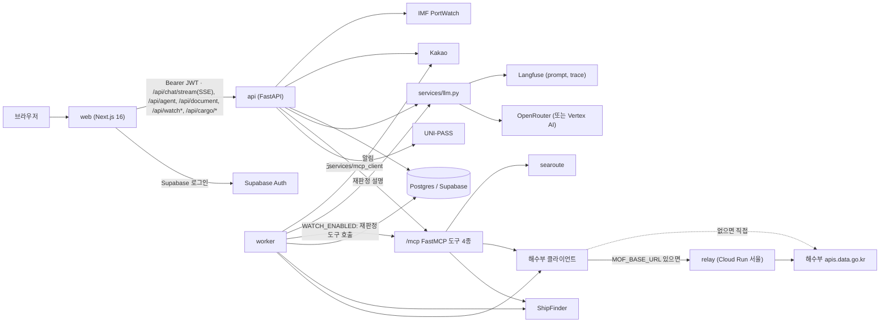

# Marvia (마르비아)

**B/L 하나로 내 화물이 제때 오는지 판정하고, 왜 그런지 근거까지 보여준다.**

부산항으로 들어오는 해상 수입 화물의 B/L 번호를 받아 "지금 신경 써야 하나?"에 순항 / 주의 / 긴급으로 답하는 LLM 에이전트입니다. 그 배가 내 배가 맞는지 확정하고, 서로 어긋나는 신호 중 무엇을 믿을지 근거로 가르고, 확정하지 못하면 판정 대신 되묻습니다.

AI Human 7기 2차 팀 프로젝트(5조) · 도메인 특화 LLM 서비스 · 2인 팀(둘 다 풀스택)으로 만든 것을 개인 포트폴리오로 정리한 레포입니다.

| | |
|---|---|
| 서비스 | https://marvia.up.railway.app (Railway `marvia-web`) · 로그인 없이 "데모 둘러보기" |
| Agent API | https://marvia-api-production.up.railway.app (Railway `marvia-api`) · `GET /health` · `POST /api/agent` |
| MCP | 위 API 주소의 `/mcp` (Bearer 토큰) |
| 기획 | [docs/Marvia_PRD.md](./docs/Marvia_PRD.md) |
| 설계 | [docs/Marvia_SDD.md](./docs/Marvia_SDD.md) · [docs/ERD.md](./docs/ERD.md) |
| 작업 기록 | [docs/Marvia_개발_작업_리스트.md](./docs/Marvia_개발_작업_리스트.md) |
| 평가 | [EVAL_REPORT.md](./EVAL_REPORT.md) |

배포 주소와 모델·프롬프트 버전은 `docs/release_manifest.json`에 적힌 값입니다. api와 web은 Railway에 있고, 배포 서버는 실제 모드(`REPLAY_MODE=false`)로 외부 API를 부릅니다. 재생 모드(`REPLAY_MODE=true`)는 키 없는 로컬 데모와 평가용입니다.

---

## 1. 문제

포워더가 일일이 챙겨주지 않는 소량 해상 수입자(스마트스토어 수입 셀러, 구매대행)는 부산항으로 들어오는 화물 몇 건을 직접 관리합니다. 추적 서비스에 ETA가 떠 있어도 **그 값을 믿어도 되는지, 그 배가 내 배가 맞는지, 유니패스 통관 단계가 무슨 뜻인지** 판단하지 못합니다. 그래서 포워더 문의와 직접 확인에 시간을 쓰고, 지연을 늦게 알아 판매 일정이 틀어집니다.

실제 AIS 데이터는 생각보다 자주 깨져 있습니다. ShipFinder 응답에서 직접 확인한 사례입니다.

- 53일 전 위치를 현재 위치처럼 반환
- 같은 선명으로 검색하면 국적이 다른 동명 선박이 섞여 나옴
- IMO 하나에 MMSI 2개 (MMSI 중복)
- 목적지가 "XX QZQZZZZZ"처럼 깨져 있음
- 항해상태는 "항해 중"인데 속도 0

팀원이 해군 함정에서 AIS·항해 상태·입출항 절차를 직접 다뤘고, 이 판독 경험이 판정 기준(Skill)이 됐습니다. 군함 데이터는 기밀이라 같은 해운 도메인의 상선 공개 데이터로 대입했습니다.

유사 서비스(트레드링스)와 다른 점은 **선박 식별 되묻기**와 **신호 상충 해석** 둘입니다. 조회한 배가 내 배라고 전제하지 않고, ETA 확률 범위 대신 왜 못 믿는지 근거를 보여줍니다. 비교 전체는 [PRD 3장](./docs/Marvia_PRD.md)에 있습니다.

## 2. 주요 기능

| 기능 | 설명 |
|---|---|
| B/L 판정 | B/L 번호(판매 예정일은 선택)로 UNI-PASS 조회 → 선박 식별 → 위치·입항 예정·거리 → 1층 신호 7종 → 판정 표 등급 → LLM 설명. 마스터·하우스는 묻지 않고 서버가 둘 다 조회합니다 |
| 되묻기 | 같은 이름 배가 여럿이고 서류로도 못 가르면 판정하지 않고 항차나 포워더 ETA를 묻거나 후보를 고르게 합니다 |
| 채팅 | 자연어 창구. 한 문장에 B/L 최대 3개 비교, 화면 화물 후속 질문, 부산 입항 예정 검색, 지켜보기·카카오톡 보내기, 웹 검색. 답 문장에는 근거 번호 `[E#]`가 붙습니다 |
| 서류 첨부 | 입항 통지서·B/L 사진이나 PDF를 채팅 입력창에 붙이면 OCR + LLM이 칸을 읽고, B/L을 확실히 읽었으면 바로 조회합니다 |
| 오늘의 화물 `/today` | 로그인 사용자의 첫 화면. 기억한 화물·지켜보는 화물·판정 변동·카카오 연결 상태 |
| 지켜보기 | 화물 지켜보기(지도, 경로선, 판정 변동 표시, 카카오톡 알림)와 B/L 없이 배만 지켜보기 |
| 화물 현황표 | 신용장별 묶음 표와 엑셀 받기 |
| 데모 둘러보기 | 소개 화면의 "데모 둘러보기"를 누르면 로그인·서버 호출 없이 가상 시뮬레이터가 배를 움직이고 판정과 판정 변동을 만듭니다. B/L이 없는 방문자용입니다 |
| 그 밖 | 구글 로그인, 화면 색(시스템·밝게·어둡게·편안하게·직접), 조회 이력, 운영자 화면(고객 관리·평가 지표), 부산항 입항 추세 카드(IMF PortWatch) |

```
입력   B/L 번호 + 판매 예정일 10/20

출력   주의
        근거  AIS ETA 10/14 vs 해수부 입항예정 10/15 09:00 → 12시간 넘게 차이
              해수부 관제 정보를 우선해 신뢰 ETA 10/15, 판매 예정일까지 여유 5일
        할 일 10/13에 다시 확인. 입항예정이 10/18 이후로 밀리면 판매 일정 조정
        통관  "입항 전" 단계, 입항 후 수입신고 → 심사 → 수리 순서
        근거 카드  ShipFinder 위치 (조회 시각) · 해수부 입항예정 (조회 시각) · UNI-PASS (조회 시각)

되묻기 선명 "TEST PAN"(가상) 후보 3척, 국적·목적지·서류로도 확정 불가
        → 판정 없이 "항차 번호나 포워더가 알려준 ETA를 알려주세요"
```

(위 출력은 형식 예시입니다. 실제 값은 조회 결과에 따라 달라집니다.)

| 판정 | 대표 상황 |
|---|---|
| 긴급 | 정박 24시간+, 목적지가 부산 아님, 통관 검사 지정, 신뢰 ETA가 판매 예정일을 넘김 |
| 주의 | 신호 하나 triggered인데 여유 일수 남음 |
| 순항 | 모든 신호 clear |
| 판정 보류 | 선박 식별 불확정 또는 위치 없음 → 물을 것 1개 이상 |

**만들지 않는 것:** 항공·육상·부산 외 항만, 창고 수령일 예측, 세액·통관 가부 판단, 결제, 이메일·푸시 알림과 알림톡.

## 3. 설계 원칙

- **판정은 2층입니다.** 1층은 코드가 신호 7종(위치 6시간 끊김, AIS ETA와 해수부 예정 12시간 차이, 부산 인근 24시간 정박, 목적지 변경·깨짐, 항해상태·속도 불일치, 통관 검사·보류, 신뢰 ETA가 판매 예정일을 넘김)을 triggered / clear / unknown으로 판정합니다. 등급(순항·주의·긴급)은 코드 판정 표가 정하고, LLM은 신호가 어긋날 때 어느 출처를 왜 믿는지와 할 일을 설명합니다. LLM은 회색 지대에서만 등급을 표 이상으로 올릴 수 있습니다.
- **숫자는 코드가 계산합니다.** 여유 일수, 거리, freshness, 신뢰 ETA는 코드가 계산하고 LLM은 덮어쓰지 못합니다. 임계값은 `skills/*/rules.md` 프론트매터가 원본입니다.
- **코드가 LLM을 막는 울타리가 있습니다.** 위치가 오래됐으면 "현재 위치" 표현 금지, 식별 불확정이면 판정 금지, 근거에 없는 숫자 거부 등 출력 검증 규칙(V1~V15)을 두고, 위반하면 재시도 3단계 후 판정 표 등급 + 고정 문구로 폴백합니다.
- **지식은 RAG가 아니라 Skill 문서로, 데이터는 MCP 도구로 가져옵니다.** LangGraph와 RAG는 쓰지 않습니다.
- **B/L은 LLM에 넘기지 않습니다.** UNI-PASS는 코드가 직접 조회하고, 중량·세관명·화주 정보는 LLM과 DB에 넣지 않습니다. 채팅 속 B/L·MRN·컨테이너 번호는 `[BL1]`·`[MRN]`·`[CNTR1]` 같은 가린 표시로만 LLM에 갑니다. 품명(goods_name)은 저장하고 채팅 에이전트에는 주지만 판정 LLM에는 주지 않습니다. 트레이스와 로그의 B/L은 가운데 절반을 가립니다(예: `TE****01`).

## 4. 아키텍처



worker의 재판정은 worker 프로세스 안에서 판정 흐름을 그대로 부르고, MCP 도구만 api의 `/mcp`를 거칩니다.

### 판정 흐름 (`POST /api/agent`)

```
1 validate    B/L 형식, 판매 예정일(선택)                    [코드]
2 customs     UNI-PASS 조회. 하우스·마스터 차례로, 둘 다 없으면 failed  [코드]
3 identify    MRN 호출부호 → 선명 검색. 1척이면 확정, 여럿이면 서류 대조 [코드]
              항차·포워더 ETA가 있을 때만 후보 고르기, 못 정하면 되묻기   [LLM]
4 collect     위치·입항예정·남은 거리                         [MCP 도구]
5 signals     1층 신호 7종, 신뢰 ETA, 여유 일수, 지난 사실       [코드]
6 verdict     판정 표 등급 (회색 지대 표시)                     [코드]
7 judge       이유·상충 해석·할 일·통관 해설                   [LLM]
8 validate    V1~V15, 위반 시 재시도 3회, 실패하면 판정 표 폴백   [코드]
→ AgentResponse (ok | partial | insufficient | failed | unsupported)
→ 화면: 판정 · 할 일 · 위치 · 통관 해설 · 하역 장소 · 근거 카드
```

모든 LLM·MCP 도구 호출은 Langfuse에 span으로 남습니다. 채팅(`POST /api/chat/stream`)은 이 흐름 앞에 붙은 자연어 창구로, 에이전트가 도구를 골라 같은 판정 흐름을 부릅니다. 단계별 입출력과 실패 처리는 [SDD](./docs/Marvia_SDD.md) 4절과 8절에 있습니다.

### 해수부 릴레이 (`relay/`)

해외(Railway 싱가포르)에서 해수부 API(apis.data.go.kr)가 ConnectTimeout으로 막혀(한국에서는 0.1초에 응답), 서울 Cloud Run에 작은 FastAPI 중계를 둡니다. `GET /1192000/VsslEtrynd5/*`, `/1192000/CntlVssl2/*`만 넘기고 `X-Relay-Token`이 맞아야 받습니다. 백엔드는 연결 대기 3초, 연결 실패는 한 번 바로 다시 부르고 두 번 실패하면 15초 동안 해수부 호출을 바로 실패시킵니다(`backend/app/clients/mof.py`). 릴레이 배포와 Railway 환경변수 설정은 확인 전입니다(`docs/release_manifest.json`). 자세한 내용은 [relay/README.md](./relay/README.md).

## 5. 디렉토리 구조

```
.
├── README.md · CLAUDE.md · AGENTS.md · EVAL_REPORT.md
├── Dockerfile            멀티스테이지 (base / app / worker). 로컬 compose용
├── Dockerfile.railway    Railway 배포용 API 이미지 (app 단계만)
├── docker-compose.yml    api(/mcp 포함) + worker + postgres 16
├── .env.example          필요한 키 목록 (값 없음)
├── backend/
│   ├── requirements.txt · requirements-doc.txt (서류 OCR, app 이미지에만)
│   ├── app/
│   │   ├── main.py        앱, 라우터 13개, /health, /mcp 마운트, 기동 때 마이그레이션
│   │   ├── auth.py · crypto.py   Supabase 로그인 토큰 확인, B/L·개인정보 암호화
│   │   ├── routers/       agent, chat, conversations, document, history, memory, profile,
│   │   │                  account, admin, kakao, watch, cargo_sheet, port
│   │   ├── schemas/       agent, signals, customs, document, memory (계약 C1~C5)
│   │   ├── services/      customs, identify, signals, verdict, llm, validate, evidence, chat,
│   │   │                  citations, memory, watch, vessel_watch, port_facts, quota, referrals 등
│   │   ├── clients/       shipfinder, mof, kakao, portwatch, supabase_admin, replay, cache, retry
│   │   ├── observability/ Langfuse 트레이스, 구조화 로그
│   │   ├── db/migrations/ 001~026 SQL. DATABASE_URL이 있으면 서버가 켜질 때 자동 적용
│   │   └── prompts/       Langfuse에서 못 가져올 때 쓰는 프롬프트 사본 10개
│   └── tests/             pytest (키 없이 돈다)
├── mcp_server/           FastMCP 도구 4종 (tools/), schemas.py(C4), auth.py
├── worker/               collector.py(위치·입항 실적 수집), watch.py(재판정), aisstream.py(시험 수집), run.py
├── relay/                해수부 API 릴레이 (Cloud Run 서울)
├── skills/               ais-reliability, customs-stages, port-busan, cargo-verdict, referrals (SKILL.md + rules.md)
├── evals/                평가셋 30건·서류 12건, fixtures/(재생 파일), results/, 실행기·채점
├── scripts/              손으로 돌리는 스크립트 (make_demo, demo_live, mcp_check, langfuse_evidence 등)
├── web/                  Next.js 16
│   ├── app/              /, /today, /watch, /cargo, /history, /settings(+kakao), /admin, /metrics, /about
│   ├── components/ · lib/ (api, auth, tour, theme, docAttach 등)
│   └── public/basemap/   미리 구워 둔 지도 타일
└── docs/                 PRD, SDD, 작업 리스트, ERD, release_manifest.json, prompt_versions.md, specs/, evidence/
```

## 6. 실행

### Docker로 띄우기

```bash
git clone https://github.com/seungwook-kim/marvia.git && cd marvia
cp .env.example .env     # 키를 채운다 (아래 표 참고)
docker compose up        # api :8000 (/api/agent, /mcp, /docs), worker, postgres
```

DB 표(마이그레이션 001~026)는 서버가 켜질 때 `DATABASE_URL`이 있으면 자동으로 만들어집니다(`backend/app/main.py` → `db.apply_migrations`). DB가 없거나 실패해도 서버는 뜹니다. 배포 DB는 Supabase, 로컬 compose는 postgres 16입니다.

worker는 `WORKER_SCHEDULE=off`(기본)이면 안내 한 줄을 남기고 바로 끝납니다(`Exited (0)`). 고장이 아닙니다.

```bash
curl http://localhost:8000/health        # {"status":"ok","db":"ok"}. DB가 끊기면 503
```

한글 경로에서는 Docker BuildKit이 실패할 수 있습니다. 그때는 `DOCKER_BUILDKIT=0 docker compose build` 후에 올립니다.

### 키 없이 데모 13건

키를 하나도 넣지 않고 순항·주의·긴급, 되묻기, 반출 완료, 실패를 끝까지 돌려 봅니다. 외부 API 응답은 가공값 재생 파일(`evals/fixtures/replay/`), 판정 LLM은 녹화 답입니다. 라이브 시연용 모의 화물 10건(`DEMO...`)과 평가셋 데모 3건(`TESTBL..`)이며, 모든 B/L·선박·포워더·컨테이너는 가공값입니다.

```bash
cp .env.example .env
# .env에서 REPLAY_MODE=false 를 REPLAY_MODE=true 로 바꾼다. 다른 칸은 비워 둔다
docker compose up -d --build
docker compose exec api python -m scripts.make_demo      # 데모 재생 파일을 지금 시각 기준으로 만든다
```

`make_demo`가 B/L 번호와 넣을 판매 예정일을 표로 보여 줍니다. 판매 예정일은 실행한 날에 따라 달라집니다(아래 `<판매일>`).

라이브 데모 10건 (시나리오는 `scripts/demo_live.py`의 `SPECS`, 펼친 문항은 `evals/fixtures/demo_live.jsonl`)

| B/L | 시나리오 | 켜지는 신호 | 기대 결과 |
|---|---|---|---|
| `DEMOQD2610001` | 칭다오에서 황해 항해 중, 여유 9일 | 없음 | `ok` · 순항(`fine`) |
| `DEMOSH2610002` | AIS ETA와 입항 예정 18시간 차이, 여유 6일 | `eta_conflict` | `ok` · 주의(`watch`) |
| `DEMONB2610003` | 도착 예정이 판매 예정일보다 2일 늦음 | `sales_date_exceeded` | `ok` · 긴급(`act`) |
| `DEMOHC2610004` | 입항·반입 뒤 세관 검사 지정 | `customs_hold` | `ok` · 긴급(`act`) |
| `DEMOTJ2610005` | 부산 30해리 안에서 0.2노트로 30시간 대기 | `anchor_wait` | `ok` · 긴급(`act`) |
| `DEMODL2610006` | 마지막 위치 수신이 10시간 전, 여유 7일 | `position_stale` | `ok` · 주의(`watch`) |
| `DEMOKH2610007` | AIS 목적지가 모지(JPMOJ), 여유 8일 | `dest_changed` | `ok` · 주의(`watch`) |
| `DEMOHP2610008` | 같은 이름 배 2척 | 없음 | `insufficient` 되묻기, 배를 고르면(`resolved_mmsi`) 순항 |
| `DEMOSH2610009` | 입항·수입신고 수리, 컨테이너 3개, 포워더 빈 칸, 여유 5일 | 없음 | `ok` · 순항(`fine`) |
| `DEMOQD2610010` | 반출신고까지 끝난 화물 | (판정 안 함) | `ok` · 순항(`fine`) |

평가셋 데모 3건

| B/L | 시나리오 | 기대 결과 |
|---|---|---|
| `TESTBL01` | 정상 | `ok` · 순항(`fine`), 여유 4일 |
| `TESTBL04` | 되묻기 | `insufficient` · 같은 이름 배 2척, 항차나 포워더 입항 예정일을 묻는다 |
| `TESTBL26` | 실패 | `partial` · 위치 조회 권한 없음, 판정 보류 |

```bash
curl -s -X POST localhost:8000/api/agent -H 'content-type: application/json' \
  -d '{"bl_no":"TESTBL01","bl_type":"HOUSE","sale_due_date":"<판매일>","session_id":"demo"}'
```

`bl_type`은 선택입니다. 빼면 서버가 하우스 → 마스터 순으로 조회합니다. 다른 B/L도 `bl_no`만 바꿔 부르고, `/docs` 화면에서 넣어 봐도 됩니다.

알아 둘 것

- 판매 예정일은 선택입니다. 비우면 정상 건은 여유 일수 없이 순항이 나옵니다. `DEMONB2610003`은 판매 예정일이 있어야 긴급이 나옵니다
- 녹화 답은 평가셋 `TESTBL01` 입력에만 맞습니다. 다른 입력이면 녹화 답을 쓰지 않고 `partial`로 끝나며, 등급은 판정 표가 정해 그대로 나오고 "설명 문장은 만들지 못했습니다" 안내가 붙습니다
- `.env`에 `LLM_MODEL`과 `OPENROUTER_API_KEY`를 넣으면 같은 데모를 진짜 LLM이 설명합니다
- 위치 수신 시각이 "만든 시각 30분 전"이라 약 5시간 반 뒤에는 오래된 위치가 됩니다. 재생 모드 서버는 4시간마다 스스로 다시 만들고(`DEMO_REFRESH`), 직접 돌릴 때는 `make_demo`를 다시 돌립니다
- Docker 없이: `python -m scripts.make_demo` 후 `REPLAY_MODE=true uvicorn backend.app.main:app --port 8000`

### 로컬에서 직접 돌리기 (Docker 없이)

```bash
python -m venv .venv && .venv/bin/python -m pip install -r backend/requirements.txt -r backend/requirements-doc.txt
.venv/bin/python -m uvicorn backend.app.main:app --port 8000     # API + MCP(/mcp)
```

윈도우는 `.venv/bin/python` 대신 `.venv\Scripts\python`입니다.

### 화면(web/)

```bash
cd web && npm install && npm run dev     # :3000. Node 20.9 이상
```

`web/.env`의 `NEXT_PUBLIC_API_BASE`를 비우면 백엔드 없이 `web/lib/fixtures` 가공 데이터로 뜨는 체험 모드, `http://localhost:8000`을 넣으면 위 API 서버에 붙는 실제 모드입니다. 소개 화면의 "데모 둘러보기"는 어느 모드에서든 서버 호출 없이 가상 시뮬레이터로 돕니다. 화면 설명은 `web/README.md`입니다.

### 환경변수

백엔드는 루트 `.env`, 화면은 `web/.env`를 읽습니다. 아래는 코드가 실제로 읽는 이름입니다.

| 키 | 용도 | 비우면 |
|---|---|---|
| `REPLAY_MODE` | `true`면 외부 API 대신 `evals/fixtures/replay/`를 읽는다 (기본 `false`) | 실제 외부 API 호출 |
| `UNIPASS_KEY` | 관세청 UNI-PASS 오픈API | B/L 조회 불가 |
| `SHIPFINDER_KEY` | ShipFinder 스타터 키 | 선박 검색·위치 조회 불가 |
| `DATA_GO_KR_KEY` | 공공데이터포털. 해수부 관제정보·선박운항정보 | 입항 예정·실적 조회 불가 |
| `MOF_BASE_URL` / `MOF_RELAY_TOKEN` | 해수부 릴레이 주소와 공유 비밀. `.env.example`에는 없으니 필요할 때 추가한다 | `apis.data.go.kr`를 직접 부른다 |
| `OPENROUTER_API_KEY` | openrouter.ai | LLM 호출 불가 |
| `LLM_MODEL` | 서비스 모델 (배포값은 `release_manifest.json`의 `google/gemini-3.5-flash-lite`). `vertex/`로 시작하면 Vertex AI | `partial`: 판정 표 등급만, 설명 문장 없음 (재생 모드는 녹화 답) |
| `GOOGLE_CLOUD_PROJECT` / `VERTEX_THINKING_BUDGET` | Vertex 경로일 때만 | |
| `MEMORY_MODEL` | 기억 뽑기·대화 제목 모델 (배포값 `openai/gpt-4o-mini`) | 기억 뽑기·제목 LLM을 건너뛴다 |
| `EVAL_COMPARE_MODEL` / `EVAL_GRADER_MODEL` | 평가 (c) 비교 모델 / 통관 해설 채점 모델 | (c)·채점을 건너뛴다 |
| `CHAT_AGENT` / `WEB_SEARCH` | 채팅 에이전트, 웹 검색 도구 (기본 on) | |
| `DAILY_TOKENS_PER_USER` | 1명당 하루 LLM 토큰 한도 (예시 100000) | 한도 없음 |
| `LANGFUSE_PUBLIC_KEY` / `LANGFUSE_SECRET_KEY` / `LANGFUSE_HOST` | Langfuse | 트레이스 없음, 프롬프트는 `backend/app/prompts/` 사본 |
| `DATABASE_URL` | Postgres (compose는 자동 지정) | 이력·기억·지켜보기 저장 없음 |
| `SUPABASE_URL` / `SUPABASE_SECRET_KEY` | 로그인 확인 / 계정 삭제·고객 목록 | 로그인이 꺼진다 |
| `BL_ENCRYPTION_KEY` / `PII_ENCRYPTION_KEY` | B/L 원본 / 회원 정보·대화·카카오 토큰 암호화 (Fernet) | 원문을 저장하지 않는다 (대화 저장도 건너뜀) |
| `KAKAO_REST_API_KEY` / `KAKAO_CLIENT_SECRET` / `KAKAO_REDIRECT_URI` | 카카오 로그인·"나에게 보내기" | 카카오톡 알림 불가 |
| `MCP_TOKEN` | `/mcp` Bearer 토큰. 배포에서는 반드시 채운다 | 재생 모드는 열리고, 실제 모드는 같은 컨테이너(루프백) 요청만 받는다 |
| `ALLOWED_ORIGINS` | CORS 허용 주소 (쉼표로 여러 개) | `http://localhost:3000`만 |
| `WORKER_SCHEDULE` / `WORKER_INTERVAL_HOURS` / `WORKER_SHIPFINDER_CALLS_PER_RUN` | 워커 주기 실행 (기본 off, 6시간, 12회) | 워커가 바로 끝난다 |
| `WATCH_ENABLED` | 워커의 지켜보는 화물 재판정 (기본 off) | 재판정 안 함 |
| `AISSTREAM_ENABLED` / `AISSTREAM_KEY` / `AISSTREAM_BBOX` | aisstream.io 시험 수집 (기본 꺼짐) | |
| `DEMO_REFRESH` | 재생 모드 데모 4시간 갱신 (기본 on) | |
| `SHIPFINDER_TIMEOUT_SEC` / `MOF_TIMEOUT_SEC` / `PORTWATCH_TIMEOUT_SEC` / `HTTP_MAX_ATTEMPTS` / `HTTP_BACKOFF_SEC` | 외부 호출 타임아웃·재시도 | 코드 기본값 |
| `NEXT_PUBLIC_API_BASE` (web) | 백엔드 주소 | 체험 모드(fixture) |
| `NEXT_PUBLIC_SUPABASE_URL` / `NEXT_PUBLIC_SUPABASE_PUBLISHABLE_KEY` (web) | 화면 로그인 | 로그인 꺼짐 |

`.env.example`의 `DAILY_COST_CAP_KRW`, `MAX_TOKENS_PER_REQUEST`는 계획만 있고 지금 코드는 읽지 않습니다.

**`SUPABASE_URL`을 채우면 로그인이 필수가 됩니다.** 요청에 `Authorization: Bearer <Supabase 로그인 토큰>`이 없으면 401, 정지된 계정은 403 `account_suspended`입니다. 키 없이 돌려 볼 때는 비워 둡니다.

```bash
python -c "import secrets; print(secrets.token_urlsafe(24))"                                  # MCP_TOKEN
python -c "from cryptography.fernet import Fernet; print(Fernet.generate_key().decode())"     # BL_/PII_ENCRYPTION_KEY
```

암호화 열쇠를 잃어버리면 저장된 값을 다시 열 수 없습니다.

### MCP 서버 확인

MCP 서버는 API 서버 안의 `/mcp` 경로입니다. 서비스 자신도 도구를 `/mcp`를 거쳐 MCP 프로토콜로 부릅니다(`backend/app/services/mcp_client.py`, Docker 이미지는 `MCP_URL=http://127.0.0.1:8000/mcp`). `MCP_URL`이 없으면(테스트·평가) 같은 프로세스의 MCP 서버에 메모리로 붙습니다. 후속 질문과 채팅에서는 LLM이 읽기 전용 도구를 직접 골라 부르고, 호출마다 Langfuse에 `mcp:<도구>` 관측이 남습니다.

```bash
python -m scripts.mcp_check http://localhost:8000/mcp   # 연결과 도구 4종 목록
python -m scripts.mcp_demo                              # 도구 4종 실제 호출
python -m scripts.mcp_auth_check                        # 토큰 없으면 401
```

도구 4종의 정의는 `mcp_server/tools/*.py`의 함수이고, 등록은 `mcp_server/server.py`의 `create_mcp()`가 루프로 합니다. 읽기 전용 표시와 스레드 실행을 4종에 똑같이 붙이기 위해서입니다.

### 테스트

```bash
pytest backend/tests mcp_server/tests     # 외부 API 키 없이 돈다 (가공 응답으로 대체)
python -m evals.run_eval --config a|b|c    # 평가 30건. b·c는 실제 LLM을 불러 비용이 든다
```

GitHub Actions `tests.yml`이 같은 pytest 범위를, `secret-scan.yml`(gitleaks)이 키 커밋을 검사합니다.

### 기술 스택

| 영역 | 사용 |
|---|---|
| Backend | FastAPI, Pydantic v2, Docker, Railway (`marvia-api`) |
| Frontend | Next.js 16, React 19, Leaflet·MapLibre 지도, Railway (`marvia-web`) |
| LLM | OpenRouter (구조화 출력, 모델 비교), Vertex AI 경로 |
| 도구 | FastMCP (Streamable HTTP), ShipFinder, 해수부 공공데이터, searoute |
| 데이터 | Supabase(배포 DB·로그인), 로컬은 PostgreSQL 16 |
| 관측·평가 | Langfuse (트레이스, Prompt, Dataset) |

### 아직 안 되는 것

| 항목 | 상태 |
|---|---|
| 실사용 기록 | 배포 서버는 실제 모드지만 실제 사용자 B/L 판정 기록은 평가에 없습니다. 해수부 릴레이 배포·실서버 확인 전입니다 (EVAL_REPORT 8절) |
| 재판정 주기 가동 | 워커 스케줄(`WORKER_SCHEDULE`)과 재판정(`WATCH_ENABLED`)은 기본 꺼짐입니다 |
| 부산 외 항만, 이메일·푸시 알림 | 만들지 않았습니다 |

## 7. 지표

실제로 돌린 결과만 적었습니다. 상세와 한계는 [EVAL_REPORT.md](./EVAL_REPORT.md), 원본은 `evals/results/`입니다.

평가셋 30건(정상 8 · 경계 14 · 실패 유도 8)은 사람이 정답을 적었고, 입력(B/L, 선박, 위치, 통관 단계, 판매 예정일)은 모두 실제 응답과 형식만 같은 가공값입니다. 외부 API는 재생 파일로 대신해 키 없이 돕니다. 지연은 재생 파일 기준이라 실제 외부 호출 시간이 빠져 있습니다.

### 모델 비교 (10-02, EVAL_REPORT 5절)

| 항목 | (a) 규칙만 | (b) openai/gpt-4o-mini | (c) qwen/qwen3-235b-a22b-2507 |
|---|---|---|---|
| 결과 파일 | `a_20261001_1631.json` | `b_20261002_1143`~`1156` (5회) | `c_20261002_1241.json` |
| 판정 정확도 (verdict_accuracy) | 1.0 | 1.0 (5회 모두) | 1.0 |
| 긴급 재현율 (act_recall) | 1.0 | 1.0 (5회 모두) | 1.0 |
| 선박 오확정 건수 | 2 (B01·B12, 동명 선박 수정 `6c737eb` 전 측정) | 0 (5회 모두) | 0 |
| 출력 계약 준수율 | 최종 응답 1.0 (LLM 출력 없음) | 최종 응답 1.0, LLM 출력 단위 98.2% (112개 중 110개) | 최종 응답 1.0, LLM 출력 단위 64.7% (34개 중 22개) |
| 통관 해설 (LLM-as-judge, 채점 gemini-2.5-flash) | 해당 없음 | 13/21 ~ 17/21 (회차별, EVAL_REPORT 4-1) | 20/21 |
| p50 / p95 지연 | 0.05초 / 0.65초 | 3.5초 / 5.5초 (150건) | 8.4초 / 30.4초 |
| 요청당 비용 | $0 (LLM 없음) | $0.000365 (5회 평균) | $0.003791 |

등급은 코드 판정 표가 정해서 (a)도 등급은 다 맞힙니다. (b)와 (c)는 판정 칸이 같고, 당시 (b)를 고른 이유는 출력 계약 준수율과 비용·지연입니다(EVAL_REPORT 5절). Langfuse 도착 기록 집계는 [docs/evidence/langfuse_summary.md](./docs/evidence/langfuse_summary.md).

### 프롬프트 개선 (10-06, EVAL_REPORT 4절 5·6번)

같은 코드·모델(gpt-4o-mini)에서 판정 프롬프트(judge)만 바꿔 1회씩 쟀습니다. 셋 다 exact 30/30, 게이트 4개 통과입니다.

| 결과 파일 | judge 버전 | 통관 해설 |
|---|---|---|
| `b_20261006_1350.json` | 8 | 13/20 (0.65) |
| `b_20261006_1051.json` | 9 | 4/20 (0.20) |
| `b_20261006_1359.json` | 10 | 20/20 (1.0) |

judge 10을 production으로 올린 뒤 같은 모델로 다시 잰 `b_20261006_1739.json`은 exact 30/30, 판정 정확도 1.0, act 재현율 1.0, 선박 오확정 0, 통관 해설 0.95(20건), p50/p95 4.0초 / 7.1초, 요청당 $0.000696입니다.

### 서비스 모델 (10-07, EVAL_REPORT 5절)

배포 서비스 모델은 `google/gemini-3.5-flash-lite`입니다. 이 모델의 평가는 OpenRouter가 아니라 Vertex AI(`vertex/google/gemini-3.5-flash-lite`)로 1회 쟀으므로 지연과 토큰은 Vertex 값입니다. 프롬프트 judge 10 · judge-eval 3 · follow-up 8, 채점 모델 `anthropic/claude-haiku-4.5`.

| 결과 파일 | exact | 판정 정확도 | act 재현율 | 선박 오확정 | 통관 해설 | p50 / p95 | LLM 호출 / 입력 토큰 (캐시) / 출력 토큰 | 비용 |
|---|---|---|---|---|---|---|---|---|
| `b_20261007_0935.json` | 30/30 | 1.0 | 1.0 | 0 | 1.0 (20건) | 1.8초 / 4.8초 | 29 / 231,184 (16,146) / 5,380 | 금액 미기록 (Vertex라 토큰만) |

게이트 4개 통과. 한계: F08에서 judge가 `bad_format`을 3번 내고 포기했습니다. 등급이 코드 판정 표에서 나와 문항은 맞았습니다.

**배포 게이트:** act 누락 1건 이상 · 선박 오확정 1건 이상 · 스키마 통과 95% 미만 · 주입 오작동 1건 이상 중 하나라도 걸리면 배포하지 않습니다.

## 8. 시크릿 규칙

- API 키·비밀번호는 `.env` 파일에만 둡니다. `.env`는 `.gitignore`에 있습니다. `.env.example`에는 키 이름만 적습니다.
- 코드에 키를 직접 적지 않습니다. `secret-scan.yml`이 push와 PR마다 검사하고, 키가 커밋되면 그 키를 재발급합니다. 히스토리에서 지워도 유출로 봅니다.
- 실제 B/L 번호와 UNI-PASS·ShipFinder 응답 원본은 커밋하지 않습니다. 평가셋과 fixture에는 가공값만 씁니다.

## 9. 데이터 출처와 라이선스

| 출처 | 쓰는 곳 | 라이선스·이용 조건 |
|---|---|---|
| [searoute-py](https://github.com/genthalili/searoute-py) (Gent Halili) | 부산항까지 남은 해상 거리 (`estimate_distance`) | Apache-2.0 |
| [Eurostat SeaRoute](https://github.com/eurostat/searoute) | searoute-py에 들어 있는 항로 네트워크 데이터의 원본 | EUPL-1.2 |
| [pycountry](https://github.com/pycountry/pycountry) | 세관 국적 코드(KR)와 ShipFinder 국적 이름(Korea, Republic of) 대조 (선박 식별) | LGPL-2.1. 수정 없이 import만 한다 |
| ShipFinder API | 선박 후보·실시간 위치·국적 | 내부 연구 목적만. 서면 동의 없이 복사·게시 금지 → 실제 응답은 레포에 넣지 않고 DB에만 둔다 |
| 관세청 UNI-PASS OpenAPI | 화물통관진행정보 | 조회 정보의 복제·타인 제공 금지 (이용약관 15조③) → 실제 응답은 레포에 넣지 않는다 |
| 해양수산부 공공데이터 (관제정보·선박운항정보) | 입항 예정·실적, 접안 시설 | 공공데이터포털 이용허락범위 제한 없음 |
| IMF PortWatch | 부산항 일일 입항 집계 (참고 카드) | 공개 데이터, 키 없음 |

레포의 테스트용 응답(`evals/fixtures/`)은 실제 응답과 형식만 같은 가공값입니다.
