# Marvia DB ERD

기준: `backend/app/db/migrations/001~026` (파일 30개). 서버(`backend/app/main.py`)와 worker가 뜰 때 `db.apply_migrations`가 이름 순서대로 한 번씩 적용한다 (SDD 3.9, `backend/app/db/__init__.py`). 전체를 pg advisory lock으로 감싸고 파일 하나를 한 트랜잭션으로 묶어, 두 프로세스가 동시에 떠도 같은 파일을 두 번 적용하지 않는다.
번호가 겹치는 파일이 있다: 016(kakao_links, token_usage), 017(cargo_watch, watch_positions), 018(conversations, db_cleanup), 021(cargo_vessel_name, watch_positions_purge). 이름 순으로 적용하므로 문제 없다. 023~026은 겹치지 않는다.
DB는 Supabase Postgres(운영·개발)와 compose의 로컬 postgres다. 모든 표에 RLS를 켜고 규칙은 두지 않는다. 공개 키(Data API)로는 못 읽고, 백엔드만 표 주인 계정으로 읽고 쓴다 (005, 이후 새 표도 모두 같은 줄을 넣었다). pg_cron이 없는 DB(compose의 로컬 postgres)에서는 각 마이그레이션이 cron 등록만 건너뛰고 지우기 함수는 만든다. worker도 실행할 때 같은 지우기 함수를 부른다.

외래 키(FOREIGN KEY)는 두 곳뿐이다: `conversation_messages`→`conversations`(018, 대화를 지우면 말풍선도 함께), `user_cargo.lc_id`→`user_lc`(019, 신용장을 지워도 화물 줄은 남기려고 SET NULL). 나머지 선은 같은 값으로 이어 읽는 논리 연결이다.
`user_id`는 Supabase 로그인 사용자 ID(UUID 글자)이고, 사용자 표 자체는 Supabase Auth(`auth.users`)에 있다.

```mermaid
erDiagram
    targets ||--o{ positions : "mmsi"
    targets ||--o{ arrival_reports : "call_sign"
    targets ||--o{ control_events : "call_sign"
    AUTH_USERS ||--o{ query_log : "user_id"
    AUTH_USERS ||--o| user_profiles : "user_id"
    AUTH_USERS ||--o| suspended_users : "user_id"
    AUTH_USERS ||--o{ user_cargo : "user_id"
    AUTH_USERS ||--o| user_memory : "user_id"
    AUTH_USERS ||--o| user_forget : "user_id"
    AUTH_USERS ||--o| kakao_links : "user_id"
    AUTH_USERS ||--o{ conversations : "user_id"
    AUTH_USERS ||--o{ user_lc : "user_id"
    AUTH_USERS ||--o{ vessel_watch : "user_id"
    AUTH_USERS ||--o{ vessel_detail_usage : "user_id = user_key"
    AUTH_USERS ||--o{ token_usage : "user_id = owner"
    AUTH_USERS ||--o{ admin_actions : "target_user_id"
    user_lc ||--o{ user_cargo : "lc_id (FK)"
    user_cargo }o--o{ watch_positions : "vessel_mmsi = mmsi"
    vessel_watch }o--o{ watch_positions : "mmsi"
    conversations ||--o{ conversation_messages : "(user_id, id) (FK)"
    operators ||--o{ operator_audit : "email_hash"

    targets { text call_sign PK
              int mmsi
              text ship_name
              timestamptz planned_at
              timestamptz selected_at }
    positions { bigserial id PK
                int mmsi
                timestamptz ts
                timestamptz fetched_at
                float lat
                float lng
                real sog
                real cog
                smallint navistat
                text dest
                text destcode
                timestamptz ais_eta
                jsonb raw }
    watch_positions { bigserial id PK
                      bigint mmsi
                      timestamptz ts
                      timestamptz fetched_at
                      float lat
                      float lng
                      real sog
                      real cog
                      smallint navistat }
    vessel_watch { text user_id PK
                   bigint mmsi PK
                   text name
                   text flag
                   text dest
                   text eta
                   timestamptz created_at
                   timestamptz updated_at }
    vessel_detail_usage { text user_key PK
                          date day PK
                          int count }
    arrival_reports { bigserial id PK
                      text call_sign
                      text ship_name
                      text ship_kind
                      text stage
                      timestamptz arrival_at
                      text facility
                      text mrn
                      timestamptz fetched_at }
    control_events { bigserial id PK
                     text call_sign
                     text ship_name
                     text kind
                     timestamptz at
                     text facility
                     timestamptz fetched_at }
    query_log { bigserial id PK
                text request_id
                text session_id
                text user_id
                text bl_masked
                text bl_encrypted
                text status
                text verdict
                text vessel_match
                text decided_by
                text trace_id
                jsonb response
                timestamptz created_at }
    user_profiles { text user_id PK
                    text name_enc
                    text phone_enc
                    text address_enc
                    timestamptz consent_at
                    timestamptz created_at
                    timestamptz updated_at }
    user_cargo { bigserial id PK
                 text user_id
                 text cargo_key
                 text bl_masked
                 text bl_encrypted
                 text bl_type
                 text label
                 text goods_name
                 text status
                 boolean watch
                 bigint lc_id FK
                 bigint vessel_mmsi
                 text last_verdict
                 timestamptz last_eta_at
                 timestamptz last_checked_at
                 timestamptz doc_facts_at
                 text doc_facts_source }
    user_lc { bigserial id PK
              text user_id
              text lc_no
              date opened_on }
    user_memory { text user_id PK
                  jsonb items
                  int version
                  jsonb previous
                  timestamptz full_at
                  timestamptz updated_at }
    user_forget { text user_id PK
                  timestamptz memo_deleted_at
                  timestamptz cargo_deleted_at }
    kakao_links { text user_id PK
                  text access_token_enc
                  text refresh_token_enc
                  timestamptz access_expires_at
                  timestamptz refresh_expires_at
                  timestamptz last_sent_at }
    conversations { text id PK
                    text user_id PK
                    text title_enc
                    text context_enc
                    text result_enc
                    timestamptz updated_at }
    conversation_messages { text user_id PK
                            text conversation_id PK
                            int seq PK
                            text role
                            text text_enc
                            text extra_enc
                            timestamptz created_at }
    token_usage { text owner PK
                  date day PK
                  int tokens
                  timestamptz updated_at }
    suspended_users { text user_id PK
                      text suspended_by
                      text reason
                      timestamptz suspended_at }
    operators { text email_hash PK
                text email_enc
                text email_masked
                text granted_by
                timestamptz granted_at
                text revoked_by
                timestamptz revoked_at }
    operator_audit { bigserial id PK
                     text action
                     text actor_user_id
                     text target_email_enc
                     text target_email_masked
                     text actor_email_enc
                     text actor_email_masked
                     timestamptz created_at }
    admin_actions { bigserial id PK
                    text action
                    text target_user_id
                    text target_email_masked
                    text actor_user_id
                    text actor_email_enc
                    text actor_email_masked
                    text reason
                    timestamptz created_at }
```

`user_cargo`는 칸이 많아 그림에는 일부만 그렸다. 전체는 아래 표에 있다. `user_cargo`·`vessel_watch`와 `watch_positions`의 선은 FK가 아니라 MMSI 값 비교다. `token_usage.owner`와 `vessel_detail_usage.user_key`는 로그인 사용자면 user_id이고, 로그인이 꺼진 환경에서는 각각 session_id, `'anonymous'`다.

## 마이그레이션 목록

| 번호 | 파일 | 만드는 것 |
|---|---|---|
| 001 | worker_tables | `targets`, `positions`, `arrival_reports`, `control_events` |
| 002 | purge_positions | `purge_old_positions()` 입항 30일 뒤 위치 삭제 + pg_cron |
| 003 | query_log | `query_log` |
| 004 | query_log_response | `query_log.response` JSONB, 세션·B/L 인덱스 |
| 005 | enable_rls | 기존 표 RLS 켜기(규칙 없음) |
| 006 | query_log_user | `query_log.user_id` |
| 007 | query_log_bl_encrypted | `query_log.bl_encrypted` |
| 008 | purge_queries | `purge_old_queries()` 90일 + pg_cron |
| 009 | operators | `operators`, `operator_audit` |
| 010 | user_profiles | `user_profiles` |
| 011 | admin_actions | `admin_actions` (INSERT만) |
| 012 | suspended_users | `suspended_users`, `admin_actions.action` 종류 확장 |
| 013 | encrypt_operator_emails | 운영자·이력 이메일을 지문·암호문·가린 값 칸으로 |
| 014 | memory_tables | `user_cargo`, `user_memory` |
| 015 | memory_conditions_purge | B/L 조건 칸, `pending`, `user_memory.full_at`, `user_forget`, `purge_done_cargo()` 3년 |
| 016 | kakao_links | `kakao_links` |
| 016 | token_usage | `token_usage` |
| 017 | cargo_watch | `user_cargo.watch, changed_from, changed_at, change_seen` |
| 017 | watch_positions | `watch_positions` |
| 018 | conversations | `conversations`, `conversation_messages`, `purge_old_conversations()` 90일 |
| 018 | db_cleanup | 안 쓰는 칸 정리(값 없을 때만), `operators` 기본 키, `query_log` 인덱스 |
| 019 | cargo_sheet | `user_lc`, `user_cargo`에 lc_id·departed_on/source·arrived_on·warehoused_on·forwarder_name·carrier_name·container_no |
| 020 | goods_name | `user_cargo.goods_name` |
| 021 | cargo_vessel_name | `user_cargo.vessel_name, vessel_flag` |
| 021 | watch_positions_purge | `purge_old_watch_positions()` 30일 |
| 022 | kakao_last_sent_at | `kakao_links.last_sent_at` |
| 023 | vessel_watch | `vessel_watch`, `purge_old_watch_positions()` 다시 정의(배만 지켜보는 배 제외) |
| 024 | eta_time_bl_type_vessel_usage | `user_cargo.last_eta_at`, `user_cargo.bl_type` NULL 허용, `vessel_detail_usage` |
| 025 | vessel_detail_usage_purge | `purge_old_vessel_detail_usage()` 7일 + pg_cron |
| 026 | doc_facts_provenance | `user_cargo.doc_facts_at`, `doc_facts_source` |

## 소스 사용 현황 (코드의 SQL 기준)

| 표 | 쓰는 곳 | 읽는 곳 | 상태 |
|---|---|---|---|
| query_log | routers/agent.py `_logged` (db `log_query`) | db `recent_queries`(이력 화면), `latest_response`·후속 질문, 탈퇴 삭제 | 사용 중 |
| user_profiles | services/profile.py | profile.py, 운영자 고객 목록, scripts/rekey_personal_data.py | 사용 중 |
| suspended_users | services/customers.py | auth.py 요청마다 확인, 고객 목록 | 사용 중 |
| operators | services/operators.py | 운영자 판단, 운영자 목록 | 사용 중 |
| operator_audit | services/operators.py | 운영자 화면 이력 | 사용 중 |
| admin_actions | services/customers.py | 운영자 화면 이력 | 사용 중 |
| schema_migrations | db/__init__.py | db/__init__.py | 사용 중 |
| targets | worker/collector.py | worker/collector.py, `purge_old_positions` | 사용 중 (worker 전용) |
| positions | worker/collector.py | db `recent_positions`(정박 대기 신호), worker | 사용 중 (칸 일부만 읽음) |
| arrival_reports | worker/collector.py | 없음 | 쓰기만. 서비스는 해수부 API를 실시간으로 부른다 |
| control_events | worker/collector.py | `purge_old_positions`만 | 쓰기만. 서비스는 해수부 API를 실시간으로 부른다 |
| user_cargo | services/memory.py, cargo.py(조회 결과·서류 조건 `doc_facts_at/source`, `services/doc_facts.py`가 부름), cargo_sheet.py, watch.py | 같은 서비스, worker/collector.py(지켜보는 배 찾기) | 사용 중 (화물 비서 기억, 화물 현황 표, 지켜보기, 서류 조건) |
| user_lc | services/cargo_sheet.py | cargo_sheet.py, cargo.py | 사용 중 (화물 현황 표의 신용장) |
| user_memory | services/memory.py | services/memory.py | 사용 중 |
| user_forget | services/memory.py | services/memory.py, `purge_done_cargo` | 사용 중 |
| kakao_links | services/kakao.py | services/kakao.py, routers/kakao.py | 사용 중 |
| token_usage | services/quota.py | services/quota.py | 사용 중 |
| watch_positions | worker/collector.py, services/cargo.py(`_keep_position`, 조회 때 받은 위치), services/watch.py(`seed_position`, 켜는 순간 첫 점), services/vessel_watch.py(캐시가 비었을 때 한 번), worker/aisstream.py(시험 수집), scripts/seed_demo_cargo.py | services/watch.py, cargo.py, vessel_watch.py, db 위치 이력 읽기 | 사용 중 (지도 표시) |
| vessel_watch | services/vessel_watch.py (routers/watch.py `/api/watch/vessels`) | vessel_watch.py, worker/collector.py(`SELECT_WATCHED`), `purge_old_watch_positions` | 사용 중 (배만 지켜보기) |
| vessel_detail_usage | services/vessel_detail.py (`take_daily_slot`) | vessel_detail.py, `purge_old_vessel_detail_usage` | 사용 중 (선박 자세히 보기 하루 횟수) |
| conversations, conversation_messages | services/conversations.py | 같은 서비스 (routers/conversations.py가 부른다), 탈퇴 삭제 | 사용 중 |

### 정리된 것
| 대상 | 처리 |
|---|---|
| query_log.retry_count, query_log.model | 018_db_cleanup이 칸에 값이 하나도 없을 때만 지운다. 값이 있으면 지우지 않고 NOTICE만 남긴다. `db/__init__.py`의 이력 응답은 model을 null로 내보낸다 |
| operators.email, operator_audit.target_email·actor_email, admin_actions.actor_email | 013에서 지문·암호문으로 옮긴 뒤 비워 둔 옛 평문 칸. 018_db_cleanup이 비어 있을 때만 지운다. 018이 `operators.email_hash`를 NOT NULL 기본 키로 올린다(비어 있는 줄이 없을 때만) |

### 정리 후보
| 대상 | 이유 |
|---|---|
| arrival_reports, control_events | 서비스가 읽지 않는다. 입항 실적 연구(사후 적중)에 쓰지 않으면 수집을 멈추고 지울 수 있다 |
| positions.cog·navistat·dest·destcode·ais_eta·raw | 서비스는 ts·lat·lng·sog만 읽는다. 연구용이면 유지, 아니면 raw(ShipFinder 원본)와 dest(자유 문장) 저장을 멈춘다 |
| query_log.bl_encrypted | 다시 조회(`latest_response` 계열)와 화물 현황 표가 읽는다. 개인 식별 값이라 쓰지 않는 사본은 줄이는 게 낫다 |
| 008의 cron 등록 | purge_old_positions 등록을 002와 같은 이름으로 다시 한다. 동작에는 문제 없다 |

조사 범위는 레포 코드(backend/app, worker, mcp_server, scripts)의 SQL이다. 실제 Supabase에 이 표들이 모두 있는지, 018이 옛 칸을 실제로 지웠는지는 DB를 직접 봐야 확인된다.

## 암호화와 가린 값

열쇠는 두 개다(`backend/app/crypto.py`, Fernet). 열쇠가 없으면 원문을 저장하지 않는다(대화는 저장 자체를 건너뜀).

| 열쇠 | 잠그는 칸 |
|---|---|
| `BL_ENCRYPTION_KEY` | `query_log.bl_encrypted`, `user_cargo.bl_encrypted`, `query_log.response` 안에서 따로 잠근 컨테이너 번호 |
| `PII_ENCRYPTION_KEY` | `user_profiles.name_enc·phone_enc·address_enc`, `kakao_links.access_token_enc·refresh_token_enc`, `conversations.title_enc·context_enc·result_enc`, `conversation_messages.text_enc·extra_enc`, `operators.email_enc`, `operator_audit.*_email_enc`, `admin_actions.actor_email_enc`, `user_memory.items` 안의 거래처 전화번호 |

| 지문·가린 값 | 칸 |
|---|---|
| HMAC 지문(되돌릴 수 없음) | `user_cargo.cargo_key`(B/L, 화물 현황 표 주소의 key), `operators.email_hash` |
| 가린 값 | `query_log.bl_masked`, `user_cargo.bl_masked`(가운데 절반 `*`), `operators.email_masked`, `operator_audit.*_email_masked`, `admin_actions.*_email_masked` |

---

## 1. 선박 수집 (worker가 쓴다, SDD 5.10)

### targets: 위치를 받을 대상 선박 (001)
| 칸 | 타입 | 설명 |
|---|---|---|
| call_sign | TEXT PK | 호출부호. 해수부 입항 신고와 ShipFinder 위치를 잇는 값 |
| mmsi | INTEGER | 선박 무선 식별 번호. ShipFinder 검색으로 찾는다. 못 찾으면 NULL이고 위치를 받지 않는다 |
| ship_name | TEXT | 선명 |
| planned_at | TIMESTAMPTZ | 대상으로 고를 때 본 부산 입항 예정 시각 |
| selected_at | TIMESTAMPTZ NOT NULL | 대상으로 고른 시각 |

### positions: 선박 위치 이력 (001, 002)
| 칸 | 타입 | 설명 |
|---|---|---|
| id | BIGSERIAL PK | 줄 번호 |
| mmsi | INTEGER | 어느 배의 위치인지. targets.mmsi와 이어진다 |
| ts | TIMESTAMPTZ | 배가 위치를 보고한 시각 (ShipFinder last_time). (mmsi, ts)는 중복 없음 |
| fetched_at | TIMESTAMPTZ | 우리가 받아 온 시각 |
| lat, lng | DOUBLE PRECISION | 위도, 경도 |
| sog | REAL | 속력(노트) |
| cog | REAL | 진행 방향(도) |
| navistat | SMALLINT | AIS 항해 상태 코드 (0 항해 중, 1 정박, 5 계류 등) |
| dest | TEXT | 배가 밝힌 목적지 원문. 아무 글이나 쓸 수 있어 LLM에 넘기지 않는다 (SDD 7절) |
| destcode | TEXT | 목적지 항구 코드 (예: KRPUS) |
| ais_eta | TIMESTAMPTZ | 배가 보낸 도착 예정 시각 |
| raw | JSONB | ShipFinder 응답 원본. DB에만 두고 레포에 올리지 않는다 (약관) |

인덱스: `positions_mmsi_ts (mmsi, ts DESC)`, 유니크 `positions_mmsi_ts_uq (mmsi, ts)` (같은 보고 시각을 다시 받아도 한 줄).
입항 30일이 지난 배의 위치는 `purge_old_positions()`가 매일 지운다 (002, pg_cron `marvia-purge-positions`, 매일 18:00 UTC).

### watch_positions: 지켜보는 배 위치 (017_watch_positions, 021_watch_positions_purge, 023)
지켜보기를 켠 화물(`user_cargo.watch`가 true이고 `status`가 active)의 배와 배만 지켜보기(`vessel_watch`)의 배 위치다. 연구용 `positions`와 따로 둔다. worker가 두 표의 MMSI를 모아 ShipFinder에서 받아 쌓고(`collect_watch_positions`), 조회 때 받은 위치(`services/cargo._keep_position`)와 지켜보기를 켜는 순간의 캐시 위치(`services/watch.seed_position`)도 같은 표에 넣는다. `AISSTREAM_ENABLED`면 aisstream 시험 수집(`worker/aisstream.py`)도 쓴다. API(`services/watch.py`, `cargo.py`, `vessel_watch.py`)가 지도에 그린다 (docs/specs/cargo-watch.md).
| 칸 | 타입 | 설명 |
|---|---|---|
| id | BIGSERIAL PK | 줄 번호 |
| mmsi | BIGINT NOT NULL | 배. `user_cargo.vessel_mmsi` 또는 `vessel_watch.mmsi`와 같은 값 |
| ts | TIMESTAMPTZ NOT NULL | 배가 위치를 보고한 시각. (mmsi, ts)는 UNIQUE |
| fetched_at | TIMESTAMPTZ NOT NULL | 받아 온 시각 |
| lat, lng | DOUBLE PRECISION NOT NULL | 위도, 경도 |
| sog, cog | REAL | 속력(노트), 진행 방향(도) |
| navistat | SMALLINT | AIS 항해 상태 코드 |

인덱스: `watch_positions_mmsi_ts (mmsi, ts DESC)`. `positions`와 달리 dest·ais_eta·raw는 저장하지 않는다.
30일이 지난 줄은 `purge_old_watch_positions()`가 지운다. 지금 지켜보는 진행 중 화물의 배와 `vessel_watch`에 있는 배의 줄은 남긴다 (021에서 만들고 023에서 다시 정의, pg_cron `marvia-purge-watch-positions`, 매일 18:40 UTC).

### vessel_watch: 배만 지켜보기 (023)
B/L 없이 채팅에서 본 배(입항 예정 목록, 후보)를 사용자별로 지켜본다 (services/vessel_watch.py, `/api/watch/vessels`). 판정·통관·알림이 없고 위치만 `watch_positions`로 같은 MMSI를 읽는다. `user_cargo`는 B/L 지문이 열쇠이고 재판정·알림이 그 줄을 읽으므로 B/L 없는 줄을 섞지 않으려고 따로 둔다. 사용자당 최대 5척(코드 상수).
| 칸 | 타입 | 설명 |
|---|---|---|
| user_id | TEXT NOT NULL | 로그인 사용자. PRIMARY KEY (user_id, mmsi), 같은 배를 두 번 켜도 한 줄 |
| mmsi | BIGINT NOT NULL | 배 |
| name | TEXT NOT NULL | 채팅에 보인 배 이름 |
| flag | TEXT | 채팅에 보인 국적 |
| dest | TEXT | 채팅에 보인 목적지 글 그대로. 표시용 데이터로만 쓰고 지시로 읽지 않는다 |
| eta | TEXT | 채팅에 보인 도착 예정 글 그대로 |
| created_at, updated_at | TIMESTAMPTZ NOT NULL DEFAULT now() | 만든 시각, 고친 시각 |

name·flag·dest·eta는 판정 값이 아니라 사용자가 화면에서 본 글이다. 길이만 잘라 저장한다.

### arrival_reports: 해수부 입항 신고 (001)
| 칸 | 타입 | 설명 |
|---|---|---|
| id | BIGSERIAL PK | 줄 번호 |
| call_sign | TEXT | 호출부호 |
| ship_name | TEXT | 선명 |
| ship_kind | TEXT | 선박 종류 |
| stage | TEXT | 신고 구분 (최초, 변경, 최종) |
| arrival_at | TIMESTAMPTZ | 신고한 입항 일시. 최종 신고면 실제 입항 시각에 가깝다 |
| facility | TEXT | 신고한 선석 또는 박지 |
| mrn | TEXT | 입항 적하목록 관리번호. UNI-PASS 화물관리번호 앞 11자리와 같아 배를 특정한다 |
| fetched_at | TIMESTAMPTZ | 이 값을 처음 본 시각 |

유니크 인덱스 `arrival_reports_uq`는 (call_sign, mrn, stage, arrival_at, facility)를 COALESCE로 빈 값을 채워 건다(NULL끼리 서로 다르게 취급되므로). 신고 내용이 바뀔 때만 새 줄이 생겨, 시간순으로 보면 예정 변경 이력이 된다. 보조 인덱스 `arrival_reports_call_sign (call_sign, fetched_at)`.

### control_events: 해수부 관제 실적 (001)
| 칸 | 타입 | 설명 |
|---|---|---|
| id | BIGSERIAL PK | 줄 번호 |
| call_sign | TEXT | 호출부호 |
| ship_name | TEXT | 선명 |
| kind | TEXT | 관제 종류 (입항, 접안, 이안, 투묘, 양묘, 출항) |
| at | TIMESTAMPTZ | 관제 일시. (call_sign, kind, at)는 중복 없음 |
| facility | TEXT | 시설. 박지면 묘박, 선석이면 접안 |
| fetched_at | TIMESTAMPTZ | 받아 온 시각 |

유니크 인덱스 `control_events_uq (COALESCE(call_sign,''), kind, at)`.

## 2. 조회 이력 (API가 쓴다)

### query_log: 조회 한 번당 한 줄 (003, 004, 006, 007, 008, 018_db_cleanup)
| 칸 | 타입 | 설명 |
|---|---|---|
| id | BIGSERIAL PK | 줄 번호 |
| request_id | TEXT | 요청 ID. 로그와 같은 값 |
| session_id | TEXT NOT NULL | 브라우저 세션. 로그인 꺼진 환경에서 사람을 가르는 값 |
| user_id | TEXT | 로그인 사용자 (006). 로그인 꺼진 환경이면 NULL |
| bl_masked | TEXT | 가운데 절반을 *로 가린 B/L (SDD 3.5) |
| bl_encrypted | TEXT | 서버 열쇠로 잠근 B/L 원본 (007, crypto.py). 로그인 사용자만, 다시 조회할 때 쓴다 |
| status | TEXT | 응답 상태 (ok, partial, insufficient, failed, unsupported) |
| verdict | TEXT | 판정 (fine=순항, watch=주의, act=긴급). 판정이 없으면 NULL. 저장 값은 영문, 화면 이름은 순항·주의·긴급 |
| vessel_match | TEXT | 선박 식별 결과 (confirmed, uncertain, none) |
| decided_by | TEXT | 등급을 누가 정했나 (rule: 판정 표, llm: 회색 지대에서 LLM이 올림) |
| trace_id | TEXT | Langfuse 트레이스 ID |
| response | JSONB | 응답 전체 (004). 후속 질문이 꺼내 쓴다. 화면 전용 UNI-PASS 처리 내역(customs_detail)은 넣지 않는다. 컨테이너 번호 평문도 넣지 않는다: customs.container_no 칸은 빼고, 다른 글자 속 번호는 [CNTR1] 번호표로 바꾸고, 번호 자체는 잠가서 따로 둔다 (`routers/agent.py _seal_containers`). `anchorage`, `customs_timing`, `eta_change`, `bl_type_used` 같은 선택 칸은 없을 수 있다 |
| created_at | TIMESTAMPTZ NOT NULL DEFAULT now() | 조회 시각 |

`retry_count`(SMALLINT)와 `model`(TEXT)은 003에서 만들었으나 쓰는 코드가 없어, 018_db_cleanup이 값이 하나도 없으면 지운다 (값이 있으면 남기고 NOTICE만 낸다).
인덱스: `query_log_session_created_idx (session_id, created_at DESC)` (003), `query_log_session_bl_created_idx (session_id, bl_masked, created_at DESC)` (004), `query_log_user_created_idx (user_id, created_at DESC)` (006), `query_log_user_bl_created_idx (user_id, bl_masked, created_at DESC)` (018_db_cleanup, 로그인 사용자의 같은 B/L 후속 질문 조회용).
90일이 지난 줄은 `purge_old_queries()`가 매일 지운다 (008, pg_cron `marvia-purge-queries`, 매일 18:10 UTC).

### vessel_detail_usage: 선박 자세히 보기 하루 횟수 (024, 025)
`GET /api/vessels/detail`에서 캐시(10분)에 없는 새 조회만 센다. 상한은 rules.md `vessel_detail_daily_limit` (services/vessel_detail.py `take_daily_slot`).
| 칸 | 타입 | 설명 |
|---|---|---|
| user_key | TEXT NOT NULL | 로그인 사용자 ID 또는 `'anonymous'`. PRIMARY KEY (user_key, day) |
| day | DATE NOT NULL | 한국 날짜 |
| count | INTEGER NOT NULL DEFAULT 0 | 그날 새로 조회한 횟수 |

7일이 지난 줄은 `purge_old_vessel_detail_usage()`가 지운다 (025, pg_cron `marvia-purge-vessel-detail-usage`, 매일 18:50 UTC).

## 3. 회원과 기억 (로그인 사용자)

### user_profiles: 회원 정보 (010)
| 칸 | 타입 | 설명 |
|---|---|---|
| user_id | TEXT PK | 로그인 사용자 |
| name_enc | TEXT | 이름. 개인정보 열쇠(PII_ENCRYPTION_KEY)로 잠근 글자만 들어간다 |
| phone_enc | TEXT | 전화번호. 잠근 글자 |
| address_enc | TEXT | 주소. 잠근 글자 |
| consent_at | TIMESTAMPTZ | 수집·이용 동의 시각 (개인정보보호법 제15조). 동의 없이는 저장하지 않는다 |
| created_at, updated_at | TIMESTAMPTZ | 만든 시각, 고친 시각 |

탈퇴하면 이 줄을 지운다 (services/account.py).

### user_cargo: 사용자의 화물 표 (014, 015, 017_cargo_watch, 019, 020, 021_cargo_vessel_name, 024, 026)
화물 비서 기억의 확실한 값과 화물 현황 표, 지켜보기, 서류 조건이 함께 쓴다 (docs/specs/memory.md, cargo-watch.md). 조회하면 services/memory.py·cargo.py가 채운다.
| 칸 | 타입 | 설명 |
|---|---|---|
| id | BIGSERIAL PK | 줄 번호 |
| user_id | TEXT NOT NULL | 로그인 사용자. UNIQUE (user_id, cargo_key) |
| cargo_key | TEXT NOT NULL | B/L 원본의 HMAC 지문. 같은 사용자 안에서 같은 화물을 찾는 데만 쓴다 |
| bl_masked | TEXT NOT NULL | 가린 B/L |
| bl_encrypted | TEXT | 잠근 B/L 원본. 줄이 지워질 때(완료 3년 뒤 purge_done_cargo, 사용자가 잊기·탈퇴) 함께 사라진다. 화물 현황 표의 엑셀 내려받기와 지켜보기 재판정만 이 값을 연다 (SDD 3.5) |
| bl_type | TEXT | MASTER, HOUSE. 024부터 NULL 허용: 구분을 모르는 줄(서류 사진만 넣고 아직 조회 전)은 비워 두고, 조회가 끝나면 UNI-PASS에서 실제로 찾은 구분으로 채운다. 다음 조회는 이 구분부터 부른다 |
| label | TEXT | 사용자가 붙인 이름표 (예: 고추). 사용자가 준 것만 쓴다 |
| goods_name | TEXT | UNI-PASS 품명 (020). 화물 비서 채팅 LLM에는 주지만 판정 LLM에는 주지 않는다. 인젝션 의심 문구는 저장 전에 버린다 |
| status | TEXT NOT NULL DEFAULT 'active' | active(진행 중), done(완료). CHECK (active, done) |
| sale_due_date | DATE | 받아야 하는 날 |
| sale_due_asked | BOOLEAN NOT NULL DEFAULT false | 받아야 하는 날을 이미 물어봤는지 |
| forwarder_eta | DATE | 포워더가 알려 준 입항 예정일 |
| forwarder_eta_noted_at | DATE | 그 예정일을 들은 날 |
| vessel_mmsi | BIGINT | 확정한 선박. 지켜보기 재판정은 이 값을 검색 없이 쓴다 |
| voyage_no | TEXT | 항차 번호 |
| vessel_source | TEXT | 선박을 어떻게 확정했는지. CHECK (mrn, user) |
| vessel_name, vessel_flag | TEXT | 확정한 선박 이름, 선적국 (021_cargo_vessel_name) |
| last_verdict | TEXT | 마지막 판정. 다음 조회 때 "지난번엔 주의"를 짚는다 |
| last_checked_at | TIMESTAMPTZ | 마지막 조회 시각 |
| last_days_margin | INTEGER | 마지막 여유 일수 |
| last_eta | DATE | 마지막 신뢰 도착 예정 (한국 날짜) |
| last_eta_at | TIMESTAMPTZ | 마지막 신뢰 도착 예정 시각 (024). 있으면 ETA 변화(`eta_change`, 재판정 알림)를 시간 단위로 센다. 옛 줄은 비어 있어 날짜로 센다 |
| last_stage | TEXT | 마지막 통관 단계 |
| done_at | TIMESTAMPTZ | 완료 시각 |
| original_bl | TEXT | 원본 B/L 상태. CHECK (required, surrendered) (015) |
| to_order_bank | BOOLEAN | 지시식 선하증권의 은행 지시 여부 (015) |
| freight_term | TEXT | 운임 조건. CHECK (prepaid, collect) (015) |
| incoterm | TEXT | 인코텀즈. CHECK (CIF, FOB, CFR) (015) |
| doc_facts_at | TIMESTAMPTZ | 서류 사진에서 위 B/L 조건을 마지막으로 저장한 시각 (026). 비어 있으면 서류 사진에서 저장한 조건이 없다 |
| doc_facts_source | TEXT | 그 조건을 읽은 서류. CHECK ('B/L', 'A/N', 'document': 종류 모름) (026). 사람이 확인하지 않은 값이라 답과 화면이 "서류 사진에서 읽은 값"이라고 밝힐 때 쓴다 |
| pending | JSONB NOT NULL DEFAULT '[]' | 대화에서 나온 값 변경 중 사용자가 아직 확인하지 않은 것 (015) |
| watch | BOOLEAN NOT NULL DEFAULT false | 지켜보기 켬 (017_cargo_watch) |
| changed_from | TEXT | 지켜보는 중 바뀐 등급의 이전 값 (017_cargo_watch) |
| changed_at | TIMESTAMPTZ | 바뀐 시각 (017_cargo_watch) |
| change_seen | BOOLEAN NOT NULL DEFAULT true | 사용자가 바뀐 것을 봤는지 (017_cargo_watch) |
| lc_id | BIGINT | 신용장. FK `user_lc(id)` ON DELETE SET NULL (019) |
| departed_on | DATE | 출항일 (019) |
| departed_source | TEXT | 출항일을 어디서 얻었나. CHECK (manual: 사용자가 넣음, document: 서류 사진에서 읽음) (019) |
| arrived_on, warehoused_on | DATE | 도착일, 입고일 (019). 조회 때 UNI-PASS 이력에서 코드가 채운다 |
| forwarder_name, carrier_name | TEXT | 포워더 이름, 선사 이름 (019) |
| container_no | TEXT | UNI-PASS 컨테이너 번호 그대로. 한 칸에 번호 하나 또는 여럿을 ", "로 이은 글 (019). 채팅 LLM에는 [CNTR1]로 가려서 준다 |
| created_at, updated_at | TIMESTAMPTZ NOT NULL | 만든 시각, 고친 시각 |

완료(done)된 지 3년이 지난 줄은 `purge_done_cargo()`가 지우고, 그 화물의 메모장 항목도 함께 뺀다 (015, pg_cron `marvia-purge-done-cargo`, 매일 18:20 UTC).

### user_lc: 신용장 (019)
화물 현황 표(`/api/cargo/sheet`)에서 화물을 신용장 번호로 묶는다 (services/cargo_sheet.py).
| 칸 | 타입 | 설명 |
|---|---|---|
| id | BIGSERIAL PK | 줄 번호 |
| user_id | TEXT NOT NULL | 로그인 사용자 |
| lc_no | TEXT NOT NULL | 신용장 번호. CHECK 길이 1~35 (services/cargo_sheet.LC_NO_MAX와 같다). UNIQUE (user_id, lc_no) |
| opened_on | DATE | 개설일 |
| created_at, updated_at | TIMESTAMPTZ NOT NULL | 만든 시각, 고친 시각 |

### user_memory: 사용자 메모장 (014, 015)
| 칸 | 타입 | 설명 |
|---|---|---|
| user_id | TEXT PK | 로그인 사용자 |
| items | JSONB NOT NULL DEFAULT '[]' | 종류가 정해진 기억 항목 목록(preference, schedule, contact, worry, todo). 거래처 전화번호는 PII 열쇠로 잠근 값. 화면용 마크다운은 코드가 만든다 |
| version | INTEGER NOT NULL DEFAULT 0 | 동시에 고칠 때 나중 것이 앞의 것을 덮지 않게 확인하는 번호 |
| previous | JSONB | 직전 버전. 잘못 고쳐졌을 때 되돌린다 |
| full_at | TIMESTAMPTZ | 메모장이 가득 찼던 시각 (015) |
| updated_at | TIMESTAMPTZ NOT NULL | 고친 시각 |

### user_forget: 잊기 표시 (015)
사용자가 메모장이나 화물 기억을 지웠다는 표시를 잠깐 남겨, 지운 직후 동시에 도는 저장이 다시 살리지 않게 한다 (services/memory.py `_FORGET_KEEP_SEC` 하루).
| 칸 | 타입 | 설명 |
|---|---|---|
| user_id | TEXT PK | 로그인 사용자 |
| memo_deleted_at | TIMESTAMPTZ | 메모장을 지운 시각 |
| cargo_deleted_at | TIMESTAMPTZ | 화물 기억을 지운 시각 |

두 시각 중 늦은 것이 하루보다 오래되면 `purge_done_cargo()`가 줄을 지운다.

### kakao_links: 카카오 알림 연결 (016_kakao_links, 022)
| 칸 | 타입 | 설명 |
|---|---|---|
| user_id | TEXT PK | 로그인 사용자 |
| access_token_enc | TEXT NOT NULL | 카카오 접근 토큰. 개인정보 열쇠로 잠근 글자 |
| refresh_token_enc | TEXT NOT NULL | 갱신 토큰. 잠근 글자 |
| access_expires_at, refresh_expires_at | TIMESTAMPTZ NOT NULL | 두 토큰의 만료 시각 |
| linked_at, updated_at | TIMESTAMPTZ NOT NULL DEFAULT now() | 연결한 시각, 고친 시각 |
| last_sent_at | TIMESTAMPTZ | 마지막으로 알림을 보낸 시각 (022) |

### token_usage: 하루 토큰 사용량 (016_token_usage)
사용자(또는 로그인 꺼진 환경의 세션)별 하루 LLM 토큰 한도를 세는 표다 (docs/specs/token-quota.md, services/quota.py).
| 칸 | 타입 | 설명 |
|---|---|---|
| owner | TEXT NOT NULL | 로그인했으면 user_id, 아니면 session_id |
| day | DATE NOT NULL | 날짜(한국 시각 자정 기준). PRIMARY KEY (owner, day) |
| tokens | INTEGER NOT NULL DEFAULT 0 | 그날 쓴 토큰 |
| updated_at | TIMESTAMPTZ NOT NULL | 고친 시각 |

### conversations, conversation_messages: 채팅 대화 목록 (018_conversations)
대화 목록이다 (services/conversations.py, routers/conversations.py). 사용자 말에 B/L·전화번호가 섞일 수 있어 글과 JSON은 모두 개인정보 열쇠로 잠근 글자만 둔다. 열쇠가 없으면 저장하지 않는다. 서류 첨부만 하고 끝난 턴도 `POST /api/conversations/{id}/attachment-turns`로 같은 표에 남긴다.
| 칸 (conversations) | 타입 | 설명 |
|---|---|---|
| id | TEXT NOT NULL | 대화 번호. 채팅 요청의 session_id와 같다. PRIMARY KEY (user_id, id) |
| user_id | TEXT NOT NULL | 로그인 사용자 |
| title_enc | TEXT | 잠근 제목 |
| context_enc | TEXT | 잠근 마지막 판정 요청(reply.request). 오른쪽 칸을 마지막 화물로 되살리는 데 쓴다 |
| result_enc | TEXT | 잠근 마지막 판정 결과(reply.agent, customs_detail 제외) |
| created_at, updated_at | TIMESTAMPTZ NOT NULL DEFAULT now() | 만든 시각, 고친 시각 |

| 칸 (conversation_messages) | 타입 | 설명 |
|---|---|---|
| user_id, conversation_id | TEXT NOT NULL | PRIMARY KEY (user_id, conversation_id, seq). FK (user_id, conversation_id)→conversations(user_id, id) ON DELETE CASCADE |
| seq | INTEGER NOT NULL | 말풍선 순서 |
| role | TEXT NOT NULL | CHECK (user, assistant) |
| text_enc | TEXT NOT NULL | 잠근 말풍선 글 |
| extra_enc | TEXT | 잠근 화면 자료(선박 목록, 지도, 화물 줄, 근거 등) |
| created_at | TIMESTAMPTZ NOT NULL DEFAULT now() | 시각 |

인덱스: `conversations_user_updated_idx (user_id, updated_at DESC)`. 마지막으로 고친 지 90일이 지난 대화는 `purge_old_conversations()`가 지운다 (018, pg_cron `marvia-purge-conversations`, 매일 18:30 UTC). 대화당 말풍선 상한과 목록 수는 코드 상수다 (services/conversations.py KEEP_MESSAGES 200, LIST_MAX 50). 탈퇴하면 대화도 함께 지운다.

### suspended_users: 지금 정지된 계정 (012)
| 칸 | 타입 | 설명 |
|---|---|---|
| user_id | TEXT PK | 정지된 사용자. 요청마다 이 표를 봐서 이미 받은 출입증도 바로 막는다 |
| suspended_by | TEXT | 정지한 운영자 |
| reason | TEXT | 정지 사유 |
| suspended_at | TIMESTAMPTZ | 정지 시각 |

해제하면 줄을 지운다. 지난 정지·해제 기록은 admin_actions에 남는다.

## 4. 운영자

### operators: 운영자 권한 (009, 013)
| 칸 | 타입 | 설명 |
|---|---|---|
| email_hash | TEXT UNIQUE | 이메일 HMAC 지문. 운영자인지 찾을 때 이것만 쓴다 (013). 비어 있는 줄이 없으면 018_db_cleanup이 NOT NULL PRIMARY KEY로 올린다 |
| email_enc | TEXT | 잠근 이메일. 운영자 화면에서만 풀어 보여 준다 |
| email_masked | TEXT | 가린 이메일 (예: ab***@e***.com). 열쇠를 잃어도 누구였는지 짐작할 수 있게 |
| email | TEXT | 예전 평문 이메일 칸(009에서 PRIMARY KEY, CHECK 소문자). 013에서 기본 키를 떼고 비워 두며, 018_db_cleanup이 비어 있으면 지운다 |
| granted_by | TEXT | 등록한 운영자 ID. 스크립트로 넣은 최초 운영자는 bootstrap |
| granted_at | TIMESTAMPTZ | 등록 시각 |
| revoked_by | TEXT | 해지한 운영자 ID. 활성이면 NULL |
| revoked_at | TIMESTAMPTZ | 해지 시각. 활성이면 NULL |

### operator_audit: 운영자 등록·해지 이력 (009, 013, INSERT만)
인덱스 `operator_audit_created_idx (created_at DESC)`. action에 CHECK (grant, revoke).
| 칸 | 타입 | 설명 |
|---|---|---|
| id | BIGSERIAL PK | 줄 번호 |
| action | TEXT | grant(등록), revoke(해지) |
| actor_user_id | TEXT | 처리한 운영자 ID. 스크립트면 bootstrap |
| target_email_enc, target_email_masked | TEXT | 대상 이메일 (잠근 값, 가린 값) |
| actor_email_enc, actor_email_masked | TEXT | 처리한 운영자 이메일 (잠근 값, 가린 값) |
| target_email, actor_email | TEXT | 예전 평문 칸. 013 이후 비워 두며, 018_db_cleanup이 비어 있으면 지운다 |
| created_at | TIMESTAMPTZ | 처리 시각 |

### admin_actions: 운영자가 고객에게 한 일 (011, 012, 013, INSERT만)
| 칸 | 타입 | 설명 |
|---|---|---|
| id | BIGSERIAL PK | 줄 번호 |
| action | TEXT | customer_update(수정), customer_delete(강제 탈퇴), unmask(가린 정보 보기), customer_suspend(정지), customer_resume(해제) |
| target_user_id | TEXT | 대상 고객 |
| target_email_masked | TEXT | 대상 가린 이메일. 탈퇴 뒤에도 누구였는지 남긴다 |
| actor_user_id | TEXT | 처리한 운영자 |
| actor_email_enc, actor_email_masked | TEXT | 처리한 운영자 이메일 (잠근 값, 가린 값) |
| actor_email | TEXT | 예전 평문 칸. 013 이후 비워 두며, 018_db_cleanup이 비어 있으면 지운다 |
| reason | TEXT | 사유. 가린 정보 보기는 필수(10~500자), 수정·탈퇴는 비어 있을 수 있다 |
| created_at | TIMESTAMPTZ | 처리 시각 |

인덱스 `admin_actions_created_idx (created_at DESC)`. action의 CHECK는 011에서 세 값으로 만들고 012가 customer_suspend, customer_resume을 더해 다시 건다.

가린 정보 보기(unmask)는 원문을 돌려주기 전에 여기에 먼저 쓴다. 쓰기에 실패하면 원문을 주지 않는다.

## 5. 시스템

### schema_migrations: 적용한 마이그레이션 (`db/__init__.py`가 만든다)
| 칸 | 타입 | 설명 |
|---|---|---|
| name | TEXT PK | 마이그레이션 파일 이름 (예: 026_doc_facts_provenance.sql) |
| applied_at | TIMESTAMPTZ | 적용 시각 |

## DB에 넣지 않는 것
- B/L 원본 평문 (가린 값, 잠근 값, 지문만)
- UNI-PASS 중량·세관명·화주 정보 (SDD 3.5, 7절). 화면 전용 처리 내역(customs_detail)도 저장하지 않는다. 예외로 품명(goods_name)은 `user_cargo.goods_name`에 저장한다 (로그인 사용자의 화물 비서 채팅용, 020)
- 회원 정보, 운영자 이메일, 카카오 토큰, 대화 글의 평문
- 서류 사진 원본 (첨부 턴은 파일 이름만 대화에 잠가 저장하고, 검사를 통과한 B/L 조건 칸 값과 출처·시각만 `user_cargo`에)

사용자가 채팅에서 본 자유 글을 그대로 두는 칸은 `vessel_watch.name·flag·dest·eta`다. 표시용이고 판정과 LLM 지시에 쓰지 않는다.
