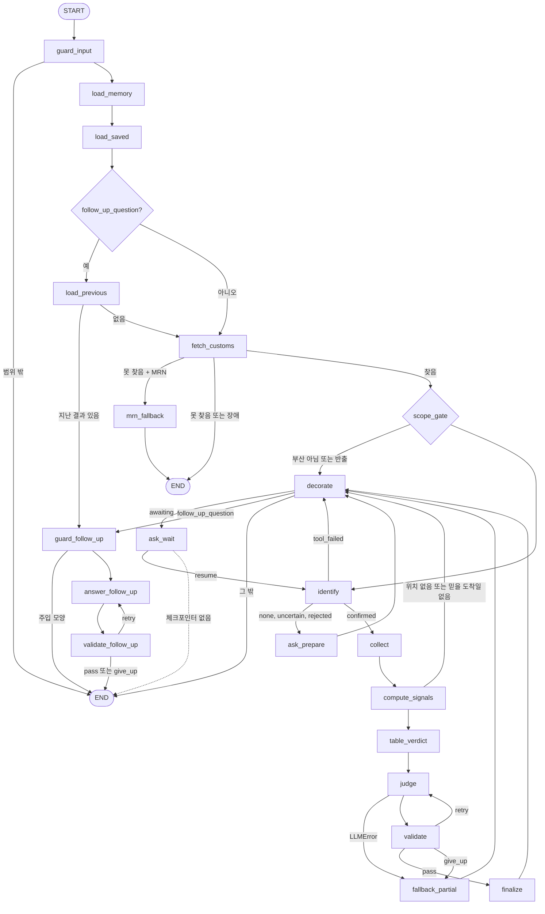

# Spec: v2 LangGraph 이전 (판정 흐름 그래프, 되묻기 interrupt, Postgres 체크포인터, 지켜보기 병렬)

상태: 초안 (2026-10-30). 구현 전. 코드는 아직 v1(태그 `v1-skill-mcp`, 커밋 119aaad)이다. 아래 "정할 것" Q1~Q12를 확인한 뒤 SDD 3.6, 3.8, 3.9, 4, 5.7, 5.10, 5.11을 먼저 고치고, 작업 리스트 "V2" 절에 H* 표를 옮긴다(CLAUDE.md "새 결정은 SDD를 먼저"). 사용자가 2026-10-30에 정한 것은 다시 열지 않는다: 전체 흐름을 LangGraph로 옮기되 등급, days_margin, 1층 신호, trusted_eta, freshness는 노드 안에서도 코드가 계산하고 LLM이 낸 값은 덮어쓴다(PRD 6.1). 순서는 (1) 판정 흐름 골격, (2) 채팅 실무 질문 RAG(`docs/specs/v2-rag.md`, 이 문서 범위 밖), (3) 서류 파이프라인 그래프(나중, 별도 Spec), (4) 평가 묶음이다. 체크포인터는 Postgres(같은 `DATABASE_URL`), 설치는 `langgraph`와 Postgres 체크포인터 패키지뿐이고 LLM SDK는 `services/llm.py`에만 둔다.

이 문서에서 "확인했다"고 쓴 것은 임시 가상환경에 실제로 설치하고 작은 예제 그래프(Marvia 코드 아님)로 돌려 본 것이다. 실제 Postgres에 붙인 확인과 Marvia 그래프를 돌린 확인은 아직 없다. 지연, 비용, 정확도 숫자는 하나도 적지 않았다.

## Why

- **상황**: 판정 흐름(SDD 4.1)은 `routers/agent.py` 한 파일의 함수 사슬(`_run` -> `_assess` -> `_after_customs`)이 순서를 정한다. 단계 사이의 값은 지역 변수와 ContextVar(`previous_eta`, `trusted_vessel`, `_db_state`)로 건너다니고, 재시도는 `for attempt in range(...)` 루프 안에 있다. 되묻기는 응답을 끝내고 사용자가 후보를 고르면 요청을 처음부터 다시 돌린다(SDD 4.3).
- **문제**:
  1. 흐름이 그림(SDD 4절 flowchart)과 코드에서 따로 산다. 단계를 하나 더하면 `_after_customs`의 if 사슬과 마지막 for 루프를 같이 읽어야 한다.
  2. 되묻기 답을 받으면 UNI-PASS 조회(하우스 -> 마스터 순서 조회 포함)와 저장 화물·기억 읽기를 처음부터 다시 한다. 이미 끝낸 앞 단계가 중복이다.
  3. 지켜보기 재판정(`run_watch`)은 화물 N건을 한 줄로 차례로 돌린다. 한 건의 지연이 뒤 건을 밀고, 건별 격리는 try/except 한 군데에 달려 있다.
  4. 단계별 시간, 시도 횟수, 어디서 멈췄는가가 트레이스에 노드 단위로 남지 않는다.
- **이 Spec의 목적**: 강의에서 배운 LangGraph(StateGraph, 조건부 엣지, interrupt/resume, checkpointer, Send)를 판정 흐름에 적용하고, v1과 같은 평가로 전후를 비교한다(README "설계 변경 기록"). v1이 틀려서가 아니다. 그래서 동작은 바꾸지 않고 구조만 옮기는 것이 원칙이고, 바뀌는 동작은 AC에 적은 것(되묻기 재개 때 앞 단계 중복 제거, 지켜보기 병렬)뿐이다.

## Goal

- **해결 목표**
  1. `/api/agent` 판정 흐름과 후속 질문 흐름을 StateGraph로 옮긴다. 응답 모양(C1, C2)은 그대로다.
  2. 후보 되묻기를 interrupt/resume으로 옮겨, 되묻기 답을 받을 때 UNI-PASS 구분 순서 조회와 앞 단계를 다시 하지 않는다(화면 전용 처리 이력 때문에 재개 때 UNI-PASS를 구분 하나로 한 번은 부른다, Q12).
  3. 체크포인트를 Postgres에 두되 B/L, 컨테이너 번호 같은 식별 값이 평문으로 남지 않게 한다.
  4. 지켜보기 재판정을 화물별 병렬(Send)로 돌리되, 한 건의 실패가 다른 건에 번지지 않고 ShipFinder 호출 상한은 그대로 지킨다.
  5. 노드마다 Langfuse span을 남긴다.
  6. 작은 단계로 나눠, 단계마다 기존 pytest가 그대로 통과한다.
- **성공 기준**: 아래 AC 전부. 바꾼 뒤에도 `pytest backend/tests mcp_server/tests`, `python -m evals.run_eval --config a`가 통과하고, v1 태그와 같은 `evals/dataset.jsonl` 30건 비교 결과가 `evals/results/`에 새 파일로 남는다.
- **Out of Scope**
  - 채팅 실무 질문 RAG(`docs/specs/v2-rag.md`). 이 문서는 그 검색 노드가 들어갈 자리만 정한다(채팅 그래프 절).
  - 서류 파이프라인(`/api/document`)의 그래프화. 나중 Spec이다.
  - 멀티에이전트, supervisor, Deep Agents, 프리빌트 에이전트와 미들웨어. 판정은 계산 파이프라인이라 맞지 않고(PRD 6.1), 채팅 도구 분할이 필요한지는 측정한 뒤 따로 정한다.
  - `langchain`, `langchain-anthropic`, `langchain-mcp-adapters`, Langfuse의 langchain CallbackHandler 설치와 사용.
  - 판정 규칙, 프롬프트, 검증 규칙(V1~V15) 변경. 코드가 옮겨 갈 뿐 규칙은 그대로다.
  - 위치 없음, 도착일 없음 응답(`_no_position`, `_no_eta`)의 interrupt화. 지금처럼 끝내고 다음 요청이 새로 돈다(Q6).

## What

**Happy Path (한 번에 끝나는 조회)**
1. 라우터가 로그인, 토큰 한도(429), 요청 루트 span을 지금처럼 처리한 뒤 `run_graph(request, user_id)`를 부른다.
2. 그래프가 판매 예정일 범위 검사, 저장된 화물 줄 읽기(지난 ETA, 저장 구분), 기억 읽기를 한다.
3. UNI-PASS 조회 -> 부산 확인 -> 반출 확인 -> 식별(confirmed) -> 위치·일정·거리 수집 -> 신호·trusted_eta·days_margin 계산(코드) -> 판정 표 등급(코드).
4. 판정 LLM 노드가 설명을 쓰고, 검증 노드가 V8, V1~V7, V9~V12, V15를 본다. 통과하면 마무리 노드가 확인처 문장과 화면 전용 칸을 붙인다.
5. 라우터 쪽 퍼사드가 조회 이력(`query_log`)과 화물 표·기억 쓰기를 지금처럼 응답 뒤에 한다. 응답은 지금과 같은 `AgentResponse`다.

**Happy Path (되묻기)**
1. 식별이 uncertain 또는 0척이면 `ask_prepare`가 지금과 같은 `insufficient` 응답(후보, `missing_inputs`)을 만들고, `ask_wait`가 interrupt로 멈춘다. HTTP 응답은 지금과 똑같다.
2. 사용자가 후보를 고르거나 항차·포워더 예정일을 넣어 같은 B/L로 다시 요청하면, 퍼사드가 멈춰 있는 그래프를 찾아 `Command(resume=...)`로 이어 간다. 이미 가진 통관 정보(정제된 `CustomsRecord`)는 다시 조회하지 않고 `identify`부터 이어 간다.
3. 멈춘 그래프가 없거나, 만료됐거나, 입력이 달라 이을 수 없으면 지금처럼 처음부터 새로 돈다(EC-02~04).

**Edge Cases**

| # | 상황 | 처리 |
| --- | --- | --- |
| EC-01 | 체크포인터가 꺼져 있음(`GRAPH_CHECKPOINT=off`, DB 없음, 열쇠 없음) | `ask_wait`는 interrupt를 부르지 않고 응답을 그대로 내며 END. 되묻기 답은 지금처럼 새 요청으로 처음부터 돈다. 응답은 v1과 같다 |
| EC-02 | 멈춘 그래프가 `graph_pause_ttl_hours`(rules.md)를 넘김 | 멈춘 스레드를 지우고 처음부터 새로 돈다. 통관 단계는 시간이 지나면 바뀌어 있을 수 있어서다 |
| EC-03 | 되묻기 뒤 요청의 `bl_type` 또는 `mrn`이 멈춘 요청과 다름 | 이을 수 없다. 스레드를 지우고 새로 돈다 |
| EC-04 | 되묻기 뒤 요청에 새 정보(`resolved_mmsi`, `voyage_no`, `forwarder_eta`)가 없음 | 같은 질문을 다시 한 것이라 새로 돈다(v1과 같다) |
| EC-05 | 같은 사용자가 같은 B/L로 요청 두 개를 동시에 보냄(더블 클릭) | 프로세스 안 스레드 잠금(thread_id별)으로 차례로 처리한다. 뒤 요청은 앞 요청이 스레드를 지운 뒤 새로 돈다. 비용이 한 번 더 들 수 있으나 결과는 맞다 |
| EC-06 | 체크포인트 읽기·쓰기 실패(DB 장애, 풀 고갈) | 로그에 종류만 남기고 체크포인터 없이 계속한다(EC-01과 같은 경로). 응답을 막지 않는다. DB 장애는 지금처럼 `db.connect`의 짧은 차단(cooldown)을 따른다 |
| EC-07 | 체크포인트 복호화 실패(열쇠 교체, 손상) | 멈춘 그래프가 없는 것으로 보고 새로 돈다. 손상된 스레드는 지운다 |
| EC-08 | 사용자가 다른 B/L로 요청함 | thread_id가 달라 서로 영향이 없다. 멈춘 스레드는 TTL까지 남는다 |
| EC-09 | 판정 재시도 중 시간 예산 초과 | 다음 시도를 시작하지 않고 지금과 같은 partial(표 등급 + 고정 문구, 회색 지대면 등급 없음) |
| EC-10 | 지켜보기 재판정 한 건이 예외 | 그 건만 실패로 세고 나머지는 결과를 반영한다. 연속 실패 기록은 지금과 같다 |
| EC-11 | 지켜보기 사용자의 오늘 토큰 한도 소진 | 그 건만 건너뛴다(`WatchError("quota")`, 연속 실패로 세지 않음). 지금과 같다 |
| EC-12 | 그래프가 상한 단계 수를 넘김(`GraphRecursionError`) | 안전망이다. 정상 경로에서는 State의 시도 횟수가 먼저 막는다. 걸리면 `log_failure("graph", "recursion_limit")`를 남기고 퍼사드가 partial로 끝낸다. 표 등급이 이미 정해져 있고 회색 지대가 아니면 `_llm_gave_up`와 같은 응답(표 등급 + `TABLE_FALLBACK`), 그 밖에는 `LLM_FAILED` 문구. `failed`는 쓰지 않는다(SDD 5.7, 통관 정보를 못 가져왔을 때만) |
| EC-13 | 계정·기록 삭제(`DELETE /api/history`, 계정 탈퇴) | 그 사용자의 멈춘 스레드도 같이 지운다(AC-14) |
| EC-14 | langgraph가 State를 되살릴 때 허용 목록에 없는 타입 | 허용 목록에 없는 객체는 dict로 되살아난다(확인했다, 아래 "스파이크"). 되묻기 재개 뒤 `state["request"].bl_no`가 깨지므로 허용 목록과 왕복 테스트를 둔다(AC-09) |
| EC-15 | 재개한 실행의 `customs_detail`(UNI-PASS 처리 이력 원문, 중량·세관명 포함이라 SDD 3.5에 따라 DB에 저장하지 않는다) | `CustomsRecord.display_rows`는 `exclude=True`라 직렬화에서 자동으로 빠지고 되살리면 빈 목록이다(확인했다). 그래서 재개한 실행의 `decorate`만 저장된 `bl_type_used` 구분 하나로 UNI-PASS를 한 번 더 불러 이력 원문을 채운다. 실패하면 `customs_detail`을 비우고 로그에 종류만 남긴다(Q12) |

## How

### 1. 설치와 의존성

`backend/requirements.txt`에 두 줄을 더한다(주석 형식은 지금 파일과 같게, 설치본 버전을 적는다).

```
langgraph>=1.2,<1.3                     # 판정 흐름 그래프 (backend/app/graph/ 안에서만 import)
langgraph-checkpoint-postgres>=3.2,<3.3 # Postgres 체크포인터. 표는 마이그레이션 032가 만든다
```

**의존성 해석 결과 (실제로 설치해 확인했다)**
- 환경: Windows 11, Python 3.11.9(Docker 이미지는 3.12라 3.12에서는 확인하지 못했다), pip 최신. `pip install "langgraph>=1,<2" langgraph-checkpoint-postgres -r backend/requirements.txt`를 한 번에 풀었다.
- 해석된 버전: langgraph 1.2.18, langgraph-checkpoint 4.3.1, langgraph-checkpoint-postgres 3.2.0, langgraph-prebuilt 1.1.1, langgraph-sdk 0.4.10, langchain-core 1.7.3, langchain-protocol 0.0.20, langsmith 0.14.16, ormsgpack 1.13.0, psycopg 3.3.6, psycopg-binary 3.3.6, psycopg-pool 3.3.3. 같이 풀린 기존 요구사항: pydantic 2.14.2, mcp 1.30.0, langfuse 4.18.0, openai 3.41.0, fastapi 0.162.0, starlette 1.10.0, httpx 0.28.1, opentelemetry-api 1.45.2.
- `pip check`: 깨진 요구사항 없음. pydantic, mcp(<2), langfuse(<5), psycopg(`psycopg[binary]>=3.2`)와 충돌하지 않았다. 체크포인터가 쓰는 드라이버는 레포와 같은 psycopg 3이다.
- **주의 하나**: `langchain-core`와 `langsmith`는 `langgraph`(그리고 `langgraph-checkpoint`)의 필수 의존성이라 "langgraph만 설치"해도 같이 들어온다. `langchain`, `langchain-anthropic` 본체는 설치되지 않는다(`import langchain` 실패 확인). CLAUDE.md와 SDD의 "langchain 계열은 설치하지 않는다"는 "`langchain`, `langchain-anthropic` 같은 상위 패키지는 없다. langgraph가 끌고 오는 langchain-core, langsmith는 의존성으로만 있고 레포 코드에서 import하지 않는다"로 고쳐 쓴다(Q1). langsmith는 환경변수(`LANGSMITH_TRACING`, `LANGCHAIN_TRACING_V2`)를 켜야만 동작하므로, 이 변수들을 `.env.example`에 두지 않고 배포 환경에 없는 것을 테스트로 확인한다(AC-15).
- 첫 시도는 가상환경 경로가 길어 `pywin32`(mcp의 Windows 의존성) 설치가 WinError 206으로 실패했다. 레포 문제가 아니라 임시 경로 길이 때문이어서 짧은 경로로 다시 해 성공했다. 확인용 가상환경은 모두 지웠다.
- 확인하지 못한 것: Python 3.12에서의 설치, Docker 이미지 빌드, 이미지 크기 변화, 실제 Postgres에 붙은 `PostgresSaver` 왕복.

**스파이크로 확인한 사실** (Marvia 코드가 아니라 작은 예제 그래프, langgraph 1.2.18, 동기 `invoke`)

| 확인한 것 | 결과 | 설계에 주는 영향 |
| --- | --- | --- |
| ContextVar가 노드 스레드로 넘어가는가 | 단일 노드, 병렬 분기, `Send` 노드 모두 호출한 쪽의 ContextVar 값이 보임. 병렬 분기 노드는 메인 스레드가 아닌 스레드에서 돌았다 | `request_id`, `_root_var`(Langfuse 루트 span), `quota.owner_var`, `progress` 듣는 쪽은 ContextVar 그대로 둔다. 비동기(`ainvoke`)는 확인하지 않았다. 동기만 쓴다 |
| `interrupt()` + `Command(resume=...)` | 체크포인터가 있으면 중단 값이 `__interrupt__`로 정상 반환되고, 같은 thread_id로 재개된다. 체크포인터가 없으면 반환은 되지만 재개할 곳이 없다 | EC-01: 체크포인터가 없으면 `interrupt()`를 부르지 않는다 |
| 멈춘 스레드에 새 입력(Command 아님)을 주면 | 처음(START)부터 다시 돌지만, 누적 리듀서(`operator.add`) 필드는 지난 값에 이어 붙었다 | 새로 돌 때는 스레드를 먼저 지운다(`delete_thread`). 리듀서 필드는 `path` 하나로 최소화한다 |
| `durability="exit"` | 중단·재개가 그대로 되고 체크포인트는 호출당 1개(`sync`는 같은 예제에서 3개, 완료까지 5개) | `durability="exit"`로 쓴다. 매 노드 쓰기를 피한다 |
| `Send` 병렬 | 건당 0.2초 3건이 0.2초에 끝남. 한 건이 예외를 내면 전체 `invoke`가 예외. 노드 안에서 try로 감싸면 나머지는 정상 | 건별 격리는 노드 안 try/except로 한다 |
| `config={"max_concurrency": N}` | 동시 실행이 N으로 제한됨(N=2에서 최대 2) | 지켜보기 병렬 폭을 rules.md 값으로 제한한다 |
| 체크포인트 저장 모양 (소스와 시험) | `PostgresSaver.put`은 State 최상위 값이 `str/int/float/bool/None`이면 `checkpoints.checkpoint` JSONB에 평문으로 넣고, 그 밖의 값만 `checkpoint_blobs`에 직렬화기를 거쳐 넣는다. `EncryptedSerializer`는 blob만 암호화한다 | 최상위 문자열 State 필드에 식별 값을 두면 암호화가 소용없다. 식별 값은 객체 안에 둔다(4절) |
| 직렬화 허용 목록 | 허용 목록에 없는 pydantic 모델은 되살릴 때 경고를 내고 dict로 돌아온다(다음 버전에서는 차단 예고). `JsonPlusSerializer(allowed_msgpack_modules=[...])`로 등록하면 모델로 돌아온다 | C1~C5 모델을 허용 목록에 등록하고 왕복 테스트를 둔다 |
| 암호화 직렬화기 | `EncryptedSerializer(cipher)`는 `encrypt(bytes) -> (이름, bytes)`, `decrypt(이름, bytes)`만 있으면 된다. Fernet으로 감싸 왕복과 평문 부재를 확인했다. 기본 제공 AES는 `pycryptodome`이 필요해 쓰지 않는다 | 이미 있는 `cryptography` Fernet(`backend/app/crypto.py`)으로 쓴다 |

### 2. 그래프 구조

코드 배치(새 패키지, langgraph import는 이 안에서만):

```
backend/app/graph/
  __init__.py
  state.py        AgentState (TypedDict), 허용 목록, 평문 허용 필드 목록
  nodes.py        판정 노드 (기존 routers/agent.py 함수를 부르는 얇은 노드)
  (followup.py는 두지 않는다. 후속 질문 노드 4개는 H5에서 nodes.py에 들어갔다)
  routes.py       조건부 엣지 함수 (판단만 한다)
  build.py        그래프 조립 (build_graph(checkpointer))
  checkpoint.py   체크포인터 만들기(off/memory/postgres), 암호화 직렬화기, thread_id
  facade.py       run_graph: 이을지 새로 돌릴지 정하고 invoke, 응답 변환
  observe.py      node_span 데코레이터 (Langfuse)
  watch_graph.py  지켜보기 재판정 그래프 (Send)
```

**원칙**
- 노드는 기존 함수를 거의 그대로 감싼다. 판정 문장, 임계값, 검증 규칙을 노드로 옮기며 새로 쓰지 않는다.
- 등급, days_margin, 1층 신호 7종, trusted_eta, freshness는 코드 노드(`compute_signals`, `table_verdict`)가 소유하고, LLM 노드(`judge`, `answer_follow_up`, `pick_vessel` 호출 부분)는 설명 칸(`judged`)만 State에 쓴다. 응답을 조립하는 `finalize`가 코드 값으로 `AgentResponse`를 만들고 LLM이 낸 등급은 V8이 허용한 범위 안에서만 쓴다(회색 지대에서 표보다 올린 경우만 `decided_by="llm"`). 이 규칙은 AC-03이 가짜 judge로 검증한다.
- 조건부 엣지 함수는 State를 보고 다음 노드 이름만 돌려준다. 호출, 저장, 숫자 비교 상수는 두지 않는다.
- `interrupt()`가 들어 있는 노드는 재개 때 처음부터 다시 돈다. 그래서 `ask_wait`에는 `interrupt` 한 줄만 두고, 외부 호출과 DB 쓰기는 앞 노드(체크포인트에 이미 저장된 결과)에 둔다.
- 요청 하나에 한 번 일어나는 DB 쓰기(`query_log`, 화물 표, 기억)는 노드가 아니라 퍼사드가 응답 뒤에 한다. 재개한 노드가 쓰기를 두 번 하지 않게 하려는 것이다.
- HTTP 일(로그인, 토큰 한도 429, 요청 루트 span, `session_scope`)은 라우터에 남는다.

**State** (필드 이름은 C1~C5를 그대로 쓴다. "평문"은 `checkpoints` JSONB에 그대로 들어가도 되는 최상위 값이다. 나머지는 객체나 dict라 blob으로 가서 암호화된다)

| 필드 | 타입, 출처 | 쓰는 노드 | 평문 허용 | 비고 |
| --- | --- | --- | --- | --- |
| `request` | AgentRequest (C2) | 입력, `load_saved`, `ask_wait` | 아니오 | B/L 원본이 들어 있다. 객체로 두어 blob이 된다 |
| `judged_request` | AgentRequest | `load_saved` | 아니오 | 저장된 판매 예정일을 채운 요청(`_run`의 `judged_request`). 판정과 `_logged`가 쓴다 |
| `saved_due` | date or None | `load_saved` | 예 | `_with_saved_due_note`용 |
| `user_id` | str or None | 입력 | 예 | Supabase 무작위 UUID. 이미 Langfuse·DB에 남는 값 |
| `bl_masked` | str | 입력 | 예 | `mask_bl` 결과만 |
| `previous_eta` | date or datetime or None | `load_saved` | 예 | **ContextVar에서 옮김**(`routers/agent.previous_eta`) |
| `trusted_vessel` | int or None | 입력(지켜보기) | 예 | **ContextVar에서 옮김**(`routers/agent.trusted_vessel`). MMSI라 식별 값이 아니다 |
| `db_failed` | bool | DB를 쓰는 노드 | 예 | **ContextVar에서 옮김**(`_db_state`). 노드 래퍼가 들어갈 때 ContextVar로 풀고 나올 때 되받는다(아래 "ContextVar 이전") |
| `resumable` | bool | 입력 | 예 | 체크포인터가 붙어 있고 thread_id를 만들 수 있으면 True |
| `memory` | `services/memory.MemoryContext` 객체 (dataclass, blocks, judge_blocks) | `load_memory` | 아니오 | 문자열 필드로 두지 않는다. 메모에 전화번호가 있을 수 있다 |
| `customs` | CustomsRecord (C5) | `fetch_customs` | 아니오 | 컨테이너 번호, 품명 포함 |
| `bl_type_used` | "MASTER" or "HOUSE" or None | `fetch_customs` | 예 | |
| `failure` | AgentResponse or None | `fetch_customs` | 아니오 | 세관 조회 실패 응답 |
| `vessel_match` | VesselMatch 또는 내부 값 "tool_failed" | `identify` | 예 | 내부 값은 응답으로 나가지 않는다(`TOOL_FAILED`) |
| `candidates` | list[VesselCandidate] | `identify` | 아니오 | |
| `mmsi`, `call_sign` | int or None, str or None | `identify` | 예 | |
| `rejected` | bool | `identify` | 예 | 사용자가 고른 배를 후보에서 확인하지 못함 |
| `position`, `schedule`, `distance` | dict or None (C4 도구 출력) | `collect` | 아니오 | |
| `position_history` | list[dict] | `collect` | 아니오 | |
| `signal_set` | SignalSet (C3) | `compute_signals` | 아니오 | |
| `trusted_eta` | datetime or None | `compute_signals` | 예 | |
| `days_margin` | int or None | `compute_signals` | 예 | 코드만 쓴다 |
| `anchored`, `eta_moved`, `port_note` | AnchorageInfo or None, EtaChange or None, `list[str]` or None | `compute_signals` | 아니오 | 코드가 센 지난 사실 3종. `port_note`는 문장 하나를 원소 1개로 담은 리스트다(아래 "문장 칸은 리스트") |
| `collected` | dict (AgentResponse 칸들) | `compute_signals` | 아니오 | 지금 `_after_customs`의 `collected`와 같다. 판정이 붙든 안 붙든 같이 나가는 값 |
| `has_position`, `from_cache` | bool | `compute_signals` | 예 | |
| `table_verdict`, `gray` | "fine"/"watch"/"act", bool | `table_verdict` | 예 | |
| `judge_attempt` | int | `judge` | 예 | 덮어쓰기. 판정 시작 때 0, 호출마다 +1 |
| `judge_feedback` | `list[str]` or None | `validate` | **아니오** | LLM이 쓴 문장 조각이 들어 있다. 문장 하나를 원소 1개로 담는다 |
| `judge_spent_sec`, `judge_last_sec` | float | `judge`, `validate` | 예 | 시간 예산용 누적(아래 "시간 예산") |
| `judged` | JudgeOutput or None | `judge` | 아니오 | LLM이 쓴 설명 칸만 |
| `violations` | list[dict] (rule, detail) | `validate` | 아니오 | |
| `judge_route` | "pass"/"retry"/"give_up" | `validate` | 예 | 엣지 함수가 읽는다 |
| `previous` | AgentResponse or None | `load_previous` | 아니오 | 후속 질문이 답할 지난 결과 |
| `follow_attempt`, `follow_feedback`, `follow_route` | int, `list[str]` or None, str | 후속 노드 | `follow_attempt`와 `follow_route`는 예, `follow_feedback`은 아니오 | `follow_feedback`에는 LLM이 쓴 문장 조각이 들어 있다. 문장 하나를 원소 1개로 담는다 |
| `follow_answer`, `follow_tool_calls`, `follow_candidates_used` | `list[str]` or None, `list[dict]`, int | `answer_follow_up` | `follow_candidates_used`만 예 | 이 표에 없던 칸(H5). `answer_follow_up`이 쓰고 `validate_follow_up`이 읽는 한 시도분이다. `follow_answer`는 LLM이 쓴 답 문장(컨테이너 번호표 포함)이라 문장 하나를 원소 1개로 담는 리스트다(평문 아님). `follow_tool_calls`는 LLM이 부른 읽기 전용 도구와 그 결과(통과한 답의 근거 카드가 된다)로 dict 리스트라 blob이 된다. `follow_candidates_used`는 후보 검색 도구를 이 질문에서 부른 횟수로, 시도를 넘어 센다(한 질문에 한 번이라는 상한이 다시 묻기로 풀리지 않게). 평문 허용 목록에는 이것만 올라 있다 |
| `follow_route` 값 | `pass`, `retry`, `give_up` | `answer_follow_up`, `validate_follow_up` | 예 | `answer_follow_up`: 답을 받았으면 `pass`(검증 전이라는 뜻일 뿐), 형식 오류·도구 거절은 `retry`, 그 밖의 호출 실패(`LLMError`)는 `give_up`과 함께 `FOLLOW_UP_FAILED` 응답. `validate_follow_up`: 통과 `pass`(응답 확정), 위반이고 상한 전이면 `retry`, 상한이면 `give_up`(`FOLLOW_UP_FAILED`). 엣지 함수는 `give_up`(앞쪽 노드에서만)과 `retry`를 보고 갈린다 |
| `awaiting` | bool | `ask_prepare` | 예 | 되묻기 대기 중 |
| `resumed` | bool | `ask_wait` | 예 | 이어 간 실행이면 True. `decorate`가 통관 처리 이력을 한 번 다시 조회할지, 노드 span이 `resumed` 메타데이터를 달지 정한다 |
| `response` | AgentResponse or None | 끝에 가까운 노드들 | 아니오 | 그래프의 결과 |
| `path` | list[str] | 모든 노드 | 예 | 지나간 노드 이름. **유일한 누적 리듀서(`operator.add`)**. 새로 돌 때 스레드를 지우므로 지난 실행이 따라오지 않는다 |

평문 허용 필드 목록(`PLAINTEXT_FIELDS`)은 `state.py`에 이름으로 고정하고, 목록에 없는 최상위 `str/int/float/bool` 필드가 State에 생기면 테스트가 실패한다(AC-09). 리듀서는 `path` 하나만 쓴다. 나머지는 덮어쓰기라서 지난 턴의 근거가 따라오지 않는다.

**평문 허용의 뜻**: `PLAINTEXT_FIELDS`는 "checkpoints JSONB에 평문으로 들어가도 되는 최상위 값의 이름"이다. 들어가야 한다는 뜻이 아니다. PostgresSaver는 `None/str/int/float/bool`만 평문으로 넣으므로, 날짜(`saved_due`, `previous_eta`, `trusted_eta`)와 객체는 목록에 있든 없든 실제로는 암호화된 blob으로 간다. 목록은 "평문으로 갈 수 있는 타입의 필드는 이 이름들뿐"이라는 상한이고, `state.py`는 langgraph를 import하지 않는다.

**문장 칸은 리스트**: `judge_feedback`, `follow_feedback`, `port_note`는 LLM이나 사용자 문장 조각이 담기는 칸이라 최상위 `str`로 두면 PostgresSaver가 JSONB에 평문으로 넣는다. 그래서 `list[str] | None`으로 두고 문장 하나를 원소 1개로 담는다(리스트는 blob이 되어 암호화된다). H3~H5의 노드는 이 칸에 `[문장]`을 쓰고 읽을 때 `"
".join(...)` 등으로 꺼낸다. 기존 코드의 `feedback`/`port_note` 문자열 변수는 노드 경계에서만 리스트로 감싼다.

**ContextVar 이전** (어느 것을 State로 옮기고 어느 것을 두는가)

| ContextVar | 처리 | 이유 |
| --- | --- | --- |
| `routers/agent.previous_eta` | State `previous_eta`로 옮김 | 판정 값에 영향을 주고, 멈춘 뒤 재개해도 같아야 한다 |
| `routers/agent.trusted_vessel` | State `trusted_vessel`로 옮김 | 지켜보기 재판정이 `Send`로 건별 병렬이 되면 ContextVar를 건별로 맞추는 것보다 입력으로 주는 쪽이 안전하다 |
| `routers/agent._db_state` | State `db_failed`로 옮김 | 같은 이유. 단 기존 도우미(`_db_ready`, `_mark_db_failed`)가 ContextVar를 읽으므로, 노드 래퍼 `db_scope(state)`가 노드 시작 때 ContextVar를 State 값으로 맞추고 끝날 때 되받는다. 도우미가 인자를 받도록 고치는 일은 H10(정리 단계)에서 한다 |
| `progress._listener`(단계 소식 듣는 쪽) | 그대로 ContextVar | HTTP 요청 하나의 일이고 체크포인트에 들어가면 안 된다. 노드는 지금처럼 `progress.step(...)`을 부른다. 스레드 전달은 확인했다 |
| `observability.langfuse._root_var`, `current_request_id`, `quota.owner_var`, `quota.checked_var` | 그대로 ContextVar | 요청 단위 값이다. 재개는 새 HTTP 요청이라 라우터가 다시 연다 |
| `services/chat._STORED_TYPES` | 그대로 | 채팅 그래프는 2단계(채팅 그래프 절) |

**노드**

| 노드 | 하는 일 (현재 코드) | LLM | 외부·DB | 재개 때 다시 돌아도 안전 |
| --- | --- | --- | --- | --- |
| `guard_input` | 판매 예정일 범위 검사(`sale_due_out_of_range`). 밖이면 insufficient 응답 | 아니오 | 없음 | 예 |
| `load_saved` | 화물 줄 읽기(`_saved_row`): 지난 신뢰 ETA, 저장 구분, 저장된 판매 예정일 -> `previous_eta`, `request.bl_type`, `judged_request` | 아니오 | DB 읽기 | 예(읽기) |
| `load_memory` | `memory_service.load_context` -> `memory`. 읽기가 실패하면 `db_failed` | 아니오 | DB 읽기 | 예(읽기) |
| `fetch_customs` | `_fetch_customs`(하우스 -> 마스터 순서, 장애는 그 자리에서 failed) | 아니오 | UNI-PASS | 재개 앞 노드라 다시 안 돈다 |
| `mrn_fallback` | 못 찾음 + MRN 있음일 때만 `mrn_fallback.assess` | 아니오 | 해수부 | 재개 앞 |
| `scope_gate` | 양륙항 != `busan_port_code` -> unsupported, 반출신고 -> `_released`(fine, LLM 없음) | 아니오 | 없음 | 예 |
| `identify` | `_identify`: 선택 MMSI -> MRN 호출부호 -> 선명 -> 서류 대조 -> `pick_vessel`(항차·포워더 예정일이 있을 때만) | 선박 선택만 | ShipFinder, 해수부 | 재개 뒤에 **다시 돈다**(새 정보로 식별) |
| `ask_prepare` | none/uncertain/rejected일 때 지금과 같은 insufficient 응답과 문구(`ASK_BACK`, `ASK_BACK_AFTER_EVIDENCE`, `RESOLVED_NOT_CANDIDATE`, `NO_VESSEL`)를 만든다. `awaiting=True` | 아니오 | 없음 | 예(순수) |
| `ask_wait` | `interrupt(payload)` 한 줄. 재개 값으로 `request`를 갱신(아래 3절) | 아니오 | 없음 | 예(순수) |
| `collect` | 위치, 입항 일정, 남은 거리, 위치 이력(`get_live_position`, `get_port_schedule`, `_distance`, `_position_history`). 도구 실패는 error로 받아 계속 | 아니오 | MCP(ShipFinder, 해수부, searoute), DB 읽기 | 앞 노드 |
| `compute_signals` | `signals.compute`, `trusted_eta`, `days_margin`, 지난 사실 3종, `evidence.build`, `collected` 조립 | 아니오 | 없음 | 예(순수) |
| `gate_no_position` / `gate_no_eta` | `_no_position`, `_no_eta`(LLM 없이 보류) | 아니오 | 없음 | 예 |
| `table_verdict` | `verdict.table_verdict`, `is_gray`, 기억 블록을 줄지 정함(회색 지대면 안 줌) | 아니오 | 없음 | 예 |
| `judge` | 시도 횟수 +1, `llm.judge` 호출. `LLMFormatError`는 `judge_feedback`을 채워 다음 단계로, `LLMError`는 포기 표시 | 판정 설명 | LLM | 예(외부 호출은 LLM뿐, 재개 경로 밖) |
| `validate` | V8(`verdict_table.allowed`) + `validate.check` + `check_judge_text`(V9, V10) + 기억을 줬으면 V12. 위반이 없으면 `pass` | 아니오 | 없음 | 예(순수) |
| `fallback_partial` | `_llm_gave_up`: 표 등급 + 고정 문구 partial, 회색 지대면 등급 없이 `LLM_FAILED` | 아니오 | 없음 | 예 |
| `finalize` | `_judged` 응답 조립, `referrals.with_signal_lines`, 저장 판매 예정일 한 줄 | 아니오 | 없음 | 예 |
| `decorate` | 화면 전용 칸 붙이기: `customs_detail`, `bl_type_used`, `customs_timing`과 그 근거 카드(unsupported는 timing 제외). 모든 응답 끝에 한 번. 재개한 실행에서 `display_rows`가 비어 있으면 UNI-PASS를 `bl_type_used` 구분 하나로 한 번 불러 채운다(EC-15) | 아니오 | 재개 때만 UNI-PASS 1회 | 예(같은 입력이면 같은 결과, 쓰기 없음) |
| `load_previous` | 후속 질문: 지난 결과 읽기(`_previous_response`) | 아니오 | DB 읽기 | 예(읽기) |
| `guard_follow_up` | 답할 지난 결과(`previous`)를 정한다: DB에 있던 것, 없어서 판정을 다시 돌렸으면 그 응답. `guard.looks_like_injection`이면 고정 문구 `FOLLOW_UP_BLOCKED`로 끝. 통과하면 `response=None`으로 비워 답 작성으로 보낸다(판정 응답이 남아 `after_guard_follow_up`이 끝으로 오해하지 않게) | 아니오 | 없음 | 예 |
| `answer_follow_up` | `llm.answer_follow_up`(읽기 전용 MCP 도구 최대 3라운드, 안은 llm.py) | 후속 답 | LLM, MCP | 예 |
| `validate_follow_up` | `FOLLOW_UP_RULES`(V1, V7, V11, V15) + V9, V10, V12. 컨테이너 번호표 처리 그대로 | 아니오 | 없음 | 예 |

**엣지**



**후속 질문 연쇄(H5 구현)**: 지난 결과가 없어 판정을 다시 돌린 연쇄는 `decorate` 뒤뿐 아니라 세관 조회 실패(`fetch_customs`가 끝으로 가던 자리)와 `mrn_fallback`의 결과 뒤에서도 `guard_follow_up`으로 합류한다. v1이 `_previous_response(...) or _assess(...)`의 결과가 조회 실패나 MRN 대체 응답이어도 그 위에 후속 답을 만들기 때문이다(`routes._end_or_follow_up`). 위 그림에는 이 두 합류 간선이 없다.

`fetch_customs`가 실패해 끝나는 경로(`failure`)와 `mrn_fallback`의 결과는 지금처럼 화면 전용 칸을 붙이지 않는다(`_assess`가 실패 응답을 그대로 돌려주는 것과 같다). `decorate`는 세관 조회에 성공한 뒤의 모든 응답에만 붙는다.

**SDD 8절 실패표와 끝점**

| SDD 8절 상황 | 그래프에서 | 응답(지금과 같다) |
| --- | --- | --- |
| UNI-PASS 결과 없음 | `fetch_customs` -> END | failed + `NO_CARGO`. MRN이 있으면 `mrn_fallback`(partial 또는 NO_CARGO에 MRN 문장 덧붙임) |
| UNI-PASS 타임아웃·장애 | `fetch_customs` -> END | failed, 남은 구분을 더 부르지 않는다 |
| 부산 외 항만 | `scope_gate` -> `decorate` | unsupported |
| 반출신고 | `scope_gate` -> `decorate` | ok + fine(rule), LLM 없음 |
| 식별 uncertain·0척 | `ask_prepare` -> `decorate` -> `ask_wait` | insufficient + 후보 + `missing_inputs` |
| 식별 검색 도구 실패 | `identify` -> `decorate` | partial(되묻지 않음) |
| 위치 없음 | `gate_no_position` | insufficient(데이터 없음) 또는 partial(도구 고장), LLM 없음 |
| 판매일은 있는데 믿을 도착일 없음 | `gate_no_eta` | insufficient + 참고용 대략 도착 |
| ShipFinder 21·23·29·38, 해수부 장애, 타임아웃 | `collect` 안에서 error로 받음 | 해당 신호 unknown, 캐시면 partial, 지금과 같다 |
| LLM 스키마 위반·검증 위반·호출 실패·시간 예산 초과 | `validate`/`judge` -> `fallback_partial` | partial, 표 등급 + 고정 문구(회색 지대면 등급 없음) |
| 후속 질문이 세 번 위반 | `validate_follow_up` -> END | 지난 결과 + `FOLLOW_UP_FAILED` |
| DB 없음·실패 | `db_failed` 표시, 이후 DB 노드 건너뜀 | 서버는 계속, 이력·기억 쓰기만 건너뜀(B7) |
| 그래프 상한 초과 | `GraphRecursionError` -> 퍼사드 | EC-12 |

**judge <-> validate 재시도 루프**
- 시도 횟수는 State(`judge_attempt`)가 센다. 상한은 `rules.md judge_max_attempts`, 시간 예산은 `judge_budget_sec`에서 읽는다(지금은 `agent.JUDGE_ATTEMPTS = 3`, `JUDGE_BUDGET_SEC = 60.0` 코드 상수다. 값은 그대로 옮기고 위치만 rules.md로 간다. `agent.JUDGE_ATTEMPTS`는 기존 테스트(`test_routers.py`)가 읽으므로 `rule(...)` 값을 가리키는 별칭으로 H10까지 남긴다).
- 포기 판단은 `validate` 뒤 엣지 함수 한 곳에서만 한다: 위반 없음 -> `pass`. 위반 있음 -> 시도 횟수가 상한이면 `give_up`, 시간 예산을 넘길 것 같으면 `give_up`(`log_failure("judge", "time budget exceeded ...")`를 남긴다), 아니면 `retry`. `LLMError`(형식 오류 아님)는 `judge`에서 바로 `fallback_partial`로 간다(재시도 안 함).
- 두 번째 재시도의 "JSON만, 규칙 준수" 덧붙임은 지금과 같은 조건(`judge_attempt == judge_max_attempts - 1`일 때 위반 피드백 뒤)에 `validate`가 `judge_feedback`에 붙인다.
- 후속 질문 루프도 같은 상한을 쓰고 같은 모양이다. 두 루프의 도우미(위반 합치기, 피드백 만들기)는 한 곳(`graph/routes.py`와 노드 도우미)으로 모은다.

**시간 예산**
- 지금 식(`(지금 - 시작) + (지금 - 방금 호출 시작) > JUDGE_BUDGET_SEC`이면 다음 시도를 안 한다)은 "그동안 쓴 시간 + 방금 한 번에 걸린 시간"이다. 그래프에서는 `judge` + `validate`가 한 번 도는 데 걸린 시간을 `judge_last_sec`에 적고 `judge_spent_sec += judge_last_sec`로 쌓은 뒤, 엣지 함수가 `judge_spent_sec + judge_last_sec > judge_budget_sec`로 본다. 시계는 지금 테스트가 바꿔 끼우는 `routers/agent`의 `time`을 노드가 똑같이 읽어(H4까지는 `agent.time.monotonic()`) `test_judge_budget.py`가 수정 없이 통과해야 한다.
- 호출 하나의 상한은 지금처럼 `llm.TIMEOUT_SEC`(60초), UNI-PASS 15초와 재시도 2회, 해수부 15초 등 **클라이언트 쪽 타임아웃**이 맡는다. 그래프 수준 노드 타임아웃은 새로 두지 않는다(동기 노드를 중간에 끊을 수 없고 외부 호출 정책(SDD 8절)이 이미 있다).
- 그래프 상한: 노드 실행 횟수의 안전망 `recursion_limit`을 `rules.md graph_recursion_limit`에서 읽어 퍼사드가 `config`로 준다. 값은 "정상 경로에서 가장 긴 경로(후속 질문 포함, 판정 3회 포함)의 노드 수를 센 값보다 커야 한다"는 기준으로 정한다. H4에서 `rules.md graph_recursion_limit: 40`으로 두었고, H5로 후속 질문 노드가 붙은 뒤 다시 세어 가장 긴 길이 25단계임을 확인했다(판정 17단계 + `guard_follow_up` + 후속 답·검증 3회 = 25). 40은 25보다 크고 H7이 늘릴 단계(`ask_prepare`, `ask_wait`)를 받을 여유가 있어 값을 그대로 둔다. 노드를 더하면 다시 센다.
- 웹은 90초에 요청을 포기한다(`AGENT_TIMEOUT_MS`, SDD 4.6). 클라이언트가 끊어도 서버 처리는 끝까지 도는 것은 지금과 같다.

### 3. 되묻기: interrupt와 resume

- **멈추는 자리**: 식별 결과가 `none`/`uncertain`/`rejected`일 때만이다(위치 없음, 도착일 없음은 Q6).
- **중단 값**: `ask_wait`는 `interrupt({"response": 응답을 model_dump(mode="json")한 dict})`를 부른다. 중단 값은 `checkpoint_writes` blob에 들어가 암호화된다. HTTP 응답은 이 `response`를 `AgentResponse`로 되살린 것이라 C1과 같다.
- **재개 값**: `{resolved_mmsi, voyage_no, forwarder_eta, sale_due_date}`(새 요청에서 꺼낸 값). `ask_wait`가 `request`의 이 칸들을 새 값으로 갱신해(새 요청이 우선, v1과 같다) `identify`로 돌아간다. 사용자가 이미 준 값을 지우지 않는다.
- **퍼사드의 결정** (`facade.run_graph`)

```
thread = thread_id(owner, cargo_key)            # 4절. 만들 수 없으면 체크포인터 없이 새로 돈다
snap = 읽기(thread)                              # 실패·복호화 실패는 None (EC-06, EC-07)
if snap 이 멈춰 있고(snap.next, 중단 값 있음) and 만료 전 and 이을 수 있음(같은 bl_type·mrn) and 새 정보가 있음:
    out = graph.invoke(Command(resume=값), config, durability="exit")
else:
    if snap: delete_thread(thread)               # 지난 실행이 따라오지 않게 (스파이크 확인)
    out = graph.invoke(처음 입력, config, durability="exit")
if out 에 __interrupt__:  response = 중단 값에서 되살림        # 스레드는 남긴다
else:                     response = out["response"]; delete_thread(thread)   # 끝난 실행은 남기지 않는다
퍼사드가 _logged(조회 이력), remember_later(화물 표·기억) 호출                 # 지금 _run 끝과 같다
```

- 끝난 실행은 체크포인트를 바로 지운다. 남겨 두면 지난 입력이 다음 실행에 끼고(스파이크의 누적 현상) 식별 값 보관 기간만 늘어난다. 디버깅용으로 남기는 옵션은 두지 않는다(Q7).
- 외부 호출 횟수: 되묻기 뒤 이어 가면 첫 요청에서 끝낸 UNI-PASS 구분 순서 조회(하우스 -> 마스터)와 저장 화물·기억 읽기를 다시 하지 않는다. 재개한 실행은 화면 전용 이력 때문에 UNI-PASS를 구분 하나로 한 번 부른다(EC-15, Q12). 식별의 ShipFinder·해수부 검색은 새 정보로 다시 하므로 v1과 같다.
- `/api/chat`, `/api/chat/stream`은 판정을 `run_agent`로 부르므로 같은 퍼사드를 탄다. 후보 칩이 `resolved_mmsi`를 실어 보내는 지금의 화면 동작이 그대로 재개가 된다. 웹 변경은 없다(두 모드, 체험 모드·데모 둘러보기 포함).

### 4. 체크포인트

**무엇을 어디에 저장하나**
- 표 4개를 `langgraph-checkpoint-postgres` 3.2.0의 것과 같은 모양으로 둔다: `checkpoints`, `checkpoint_blobs`, `checkpoint_writes`, `checkpoint_migrations`. 레포 밖 표가 아니라 같은 DB(`DATABASE_URL`, Supabase 세션 풀러 5432)다.
- **마이그레이션 번호는 032**다(현재 가장 큰 번호는 `031_watch_positions_source.sql`. SDD 3.9 본문이 말하는 001~026은 오래됐다. 그 문서도 고친다). 파일: `backend/app/db/migrations/032_graph_checkpoints.sql`.
  - 라이브러리가 쓰는 `setup()`에 맡기지 않고 우리 마이그레이션이 표를 만든다. 이유: `setup()`은 `CREATE INDEX CONCURRENTLY`를 쓰는데 `db.apply_migrations`는 파일 하나를 트랜잭션으로 묶어 실행해 거기서 못 돌고, 새 표에 RLS를 켜는 레포 규칙(005 이후)을 `setup()`이 모른다.
  - 032는 (a) 라이브러리 0~9번 마이그레이션이 만드는 표와 같은 DDL(색인은 `CONCURRENTLY` 없이 일반 `CREATE INDEX IF NOT EXISTS`, 표가 비어 있어 문제없다), (b) `checkpoint_migrations`에 v0~v9 기록, (c) 네 표에 RLS 켜기, (d) 정리 함수 `purge_old_graph_checkpoints(days integer)`를 만든다. 함수는 `checkpoints.checkpoint->>'ts'`가 오래된 스레드의 네 표 행을 지운다(008, 018의 `purge_old_*`와 같은 방식, pg_cron이 있으면 등록).
  - 라이브러리를 올리면 `PostgresSaver.MIGRATIONS` 길이가 늘 수 있다. 032가 기록한 버전 수와 `len(PostgresSaver.MIGRATIONS)`가 같은지 보는 테스트(AC-10)가 올림 때 새 마이그레이션(033)이 필요함을 알린다. 의존성은 `>=3.2,<3.3`으로 묶는다.
  - 스레드 목록·만료용 표는 따로 두지 않는다. 만료는 재개 때 `StateSnapshot.created_at`으로, 정리는 정리 함수(`checkpoint->>'ts'`)로 본다.
- **저장되는 것**: 그래프가 멈춰 있는 동안의 State(위 표) 전체와 중단 값. 끝난 실행은 저장하지 않고 지운다. State에는 UNI-PASS 응답 중 `CustomsRecord`(C5)의 정제된 칸만 있다. 중량, 세관명, 화주는 애초에 모델에 없다(SDD 3.5). 화면 전용 처리 이력 원문(`display_rows`, 중량·관세법인명이 들어 있다)은 모델에서 `exclude=True`라 체크포인트로 가지 않는다(직렬화해 보니 blob에 없고 되살리면 빈 목록이었다). 그래서 SDD 3.5의 "DB에 저장하지 않는다"가 체크포인트에도 지켜지고, 대신 재개한 실행은 EC-15대로 한 번 다시 받는다. 컨테이너 번호와 품명은 `CustomsRecord`에 있어 blob 안에서 암호화된다.

**마스킹과 암호화 (식별 값이 평문으로 남지 않게)**
1. **직렬화기를 암호화로 감싼다**: `EncryptedSerializer(FernetCipher, JsonPlusSerializer(allowed_msgpack_modules=허용 목록))`. `FernetCipher`는 `backend/app/crypto.py`의 B/L 열쇠(`BL_ENCRYPTION_KEY`)를 쓴다. `crypto.py`에 바이트용 `encrypt_bytes/decrypt_bytes` 두 함수를 더한다(Fernet, 기존 `_fernet`과 같은 열쇠 처리와 로그). 모든 blob(객체로 둔 State 값, 쓰기 대기 값, 중단 값, `Send` 인자)이 암호화된다. 허용 목록은 명시한 클래스뿐이다(`graph/checkpoint.py MSGPACK_ALLOWLIST`): C2(`AgentRequest`)와 C1의 모든 모델(`AgentResponse`, `Evidence`, `Reason`, `Conflict`, `VesselCandidate`, `VesselInfo`, `Position`, `EtaInfo`, `CustomsInfo`, `BerthInfo`, `AnchorageInfo`, `StageElapsed`, `CustomsTiming`, `EtaChange`), C3(`Signal`, `SignalSet`), C5(`CustomsRecord`, `CustomsStage`, `CustomsDetailRow`), 그리고 `JudgeOutput`, `CustomsExplanation`(`JudgeOutput`에 중첩), `services/memory.MemoryContext`. 중첩 모델은 상위 모델 안에서는 dict로 직렬화되어 되살릴 때 검증되지만, `collected`와 `candidates`처럼 dict·리스트 안에 모델이 직접 들어가는 칸이 있어 C1 모델을 모두 올린다. C4(`mcp_server/schemas.py`)는 State에서 `position`, `schedule`, `distance`가 dict 그대로 다니므로 목록에 넣지 않는다. 목록 밖 타입은 `LANGGRAPH_STRICT_MSGPACK` 환경변수와 상관없이 되살릴 때 막힌다(명시 목록을 넘겼기 때문). 새 모델을 State에 쓰려면 목록에 일부러 더해야 하고, `test_graph_state.py`가 빠진 것을 잡는다.
2. **평문 컬럼에 식별 값이 가지 않게 한다**: `checkpoints.checkpoint`(JSONB)에는 최상위 원시 값 필드와 채널 이름·버전이 평문으로 들어가고 `metadata`(JSONB)에는 config의 `configurable`·`metadata` 중 원시 값이 들어간다(소스로 확인했다). 그래서 (a) State의 최상위 문자열·숫자 필드는 `PLAINTEXT_FIELDS`에 있는 것만 허용하고, B/L, 컨테이너 번호, 메모 문장, LLM이 쓴 문장은 객체 안에 둔다. (b) 퍼사드는 `config`에 `thread_id`, `recursion_limit` 외에는 아무것도 넣지 않는다(user_id, B/L을 `configurable`·`metadata`에 넣지 않는다). (c) 노드 이름·채널 이름에 값이 들어가지 않는다.
3. **열쇠가 없으면 저장하지 않는다**: `BL_ENCRYPTION_KEY`가 없거나 틀리면 체크포인터를 만들지 않는다(EC-01). SDD 3.9 "열쇠가 없으면 원문을 저장하지 않는다"와 같은 규칙이다. 로컬 compose처럼 열쇠 없이 돌면 되묻기는 v1처럼 새 요청이다.
4. **thread_id에 B/L을 넣지 않는다** (아래).
5. **트레이스·로그**: 노드 span의 input·output은 비운다(7절). 체크포인트 읽기·쓰기 실패 로그는 종류만 남긴다(`log_failure`).

**thread_id 설계**
- 형식: `verdict:{owner}:{cargo}`. `owner` = `sha256(quota.owner_key(session_id, user_id))`의 앞 16자(로그인 사용자는 `user:{uuid}`, 아니면 `session:{session_id}`를 해시해 임의 문자열이 id에 들어가지 않게 한다). `cargo` = `cargo.cargo_key(bl_no)`(B/L의 HMAC 지문, 되돌릴 수 없음)의 앞 32자.
- 효과: 같은 사용자가 같은 B/L로 이은 요청만 같은 스레드가 된다. 사용자가 다르면 B/L이 같아도 스레드가 다르고(격리), 한 사용자의 B/L 여러 건은 서로 다른 스레드다. 비로그인 사용자는 같은 `session_id`에서만 이어진다.
- `cargo_key`를 만들 수 없으면(열쇠 없음) 체크포인터 없이 돈다(EC-01).
- 후속 질문과 채팅은 스레드를 만들지 않는다(멈출 일이 없다).

**연결**
- `psycopg_pool.ConnectionPool`(`autocommit=True`, `prepare_threshold=0`, `row_factory=dict_row`, `max_size`는 `GRAPH_DB_POOL_MAX`)을 `PostgresSaver`에 준다. 라이브러리 요구 조건이다. 레포의 `db.connect()`는 `dict_row`를 안 쓰고 `options`(statement_timeout)를 보내므로 그대로 줄 수 없다. 접속 문자열은 `db.plain_url(DATABASE_URL)`. 연결 대기 상한과 `DB_DOWN_COOLDOWN_SEC` 같은 실패 기억은 `db.connect`와 같은 태도를 따른다(풀을 열지 못하면 체크포인터 없이 계속, EC-06). 풀 크기는 Supabase 무료 풀러의 연결 수를 아껴야 해서 작게 둔다(Q8).
- 풀은 api 기동 때 게으르게 열고 `lifespan` 종료 때 닫는다(`main.py`). worker는 판정 그래프에 체크포인터를 쓰지 않는다.

**보관과 정리**
- 끝난 실행: 즉시 삭제. 멈춘 실행: `graph_pause_ttl_hours`(rules.md)가 지나면 다음 요청에서 지운다(EC-02). 어느 요청도 오지 않는 스레드: worker가 `purge_old_graph_checkpoints(rule("graph_checkpoint_retention_days"))`를 부른다(`worker/run.py`의 다른 `purge_*` 옆, 90일·30일 같은 기간을 SQL에 박지 않고 인자로 준다).
- 계정 삭제·`DELETE /api/history`: 그 사용자 해시(`owner`)로 시작하는 스레드를 같은 트랜잭션 흐름에서 지운다(`services/account.py`, `routers/history.py`). 로그인하지 않은 세션의 스레드는 TTL과 정리 함수가 맡는다.

### 5. HTTP 계약과 바뀌는 파일

**응답 모양은 바뀌지 않는다.** `/api/agent`는 `AgentResponse`(C1), 요청은 `AgentRequest`(C2) 그대로다. `thread_id`, `resume` 같은 칸은 추가하지 않는다. 퍼사드가 서버 안에서 thread_id를 만들고 이을지 정한다. `/api/chat`, `/api/chat/stream`의 `ChatResponse`, SSE 이벤트(`progress`, `result`, `error`)도 그대로다. 이 Spec은 채팅 계약에 칸을 더하지 않는다(채팅 그래프를 옮길 때 칸이 필요하면 칸 추가만 허용, 그때 SDD 3절을 같이 고친다).

| 파일 | 바뀌나 | 내용 |
| --- | --- | --- |
| `backend/app/schemas/agent.py` (C1, C2) | **안 바뀜** | |
| `backend/app/schemas/signals.py` (C3), `schemas/customs.py` (C5) | 안 바뀜 | 직렬화 허용 목록에 등록만 한다. `CustomsRecord`의 `display_rows`가 State로 가지 않게 하는 처리는 그래프 쪽에서 한다 |
| `mcp_server/schemas.py` (C4) | 안 바뀜 | |
| `evals/schema.py` (C7), `evals/dataset.jsonl` | 안 바뀜 | 평가셋을 건드리지 않는다 |
| `skills/cargo-verdict/rules.md` (C6) | **바뀜** | 키 추가: `judge_max_attempts`, `judge_budget_sec`, `graph_pause_ttl_hours`, `graph_recursion_limit`, `graph_checkpoint_retention_days`. 값은 `judge_*`는 지금 코드 상수(3, 60)를 그대로 옮기고 나머지는 Q4에서 정한다 |
| `skills/port-busan/rules.md` (C6) | **바뀜** | 키 추가: `watch_parallel_max`(`watch_pause_after_failures` 옆) |
| `.env.example` (C8) | **바뀜** | 키 이름만 추가: `AGENT_GRAPH`(on/off, 기본 on(H9), 비교용 전환 스위치), `GRAPH_CHECKPOINT`(auto/off/memory/postgres), `GRAPH_DB_POOL_MAX`. 배포·compose 환경변수 문서(`deploy/README.md`, `render.yaml`)에는 기본값을 쓰는 한 추가 없음 |
| `backend/requirements.txt` | 바뀜 | 위 두 줄 |
| `backend/app/db/migrations/032_graph_checkpoints.sql` | 새 파일 | 4절 |
| `backend/app/crypto.py` | 바뀜(추가만) | `encrypt_bytes`, `decrypt_bytes` |
| `backend/app/routers/agent.py` | 바뀜 | H2~H3: 노드가 부르는 기존 함수는 그대로 두고 `run_agent`가 플래그에 따라 퍼사드를 부른다. H10: 노드가 쓰는 도우미를 `graph/`로 옮기고 테스트의 패치 대상을 같이 고친다 |
| `backend/app/observability/langfuse.py` | 바뀜(추가) | 노드 span(7절) |
| `backend/app/services/watch.py`, `worker/run.py`, `worker/watch.py` | 바뀜 | 6절 |
| `backend/app/main.py` | 바뀜 | 풀 열기·닫기(lifespan) |
| SDD 3.6, 3.8, 3.9, 4.1, 4.3, 5.7, 5.10, 5.11, 8, 9 / `docs/ERD.md` / CLAUDE.md "langchain 계열" 문구 / 작업 리스트 V2 절 | 바뀜 | 구현 전에 먼저 고친다 |
| `web/` 전체 | **안 바뀜** | |

### 6. 지켜보기 재판정 병렬

현재(`services/watch.run_watch`): 마지막 확인이 가장 오래된 화물부터 `limit`건(`RUN_LIMIT=5`)을 한 줄로 판정하고, 건마다 DB 쓰기와 알림을 이어서 한다. 한 건 실패는 try/except로 세고 넘어간다.

**그래프(`graph/watch_graph.py`, 체크포인터 없음)**

```
START -> select_due -> (Send 화물마다) assess_one -> apply_results -> END
```

- `select_due`(순차): `_resend_pending`(못 보낸 알림 다시 보내기), `_due_rows(limit, known_vessel_only)`로 화물 행을 고른다. 여기서 개수가 정해진다. `Send`는 이 행 수만큼만 만든다.
- `assess_one`(병렬, 건별): 행 하나로 `AgentRequest`를 만들고(B/L 복호화, 판매 예정일 범위 검사, 오늘 토큰 한도 확인) 판정 그래프(체크포인터 없음)를 부른다. 입력으로 `trusted_vessel=mmsi`, `previous_eta`를 State에 준다(ContextVar를 쓰지 않는다). **노드 전체를 try/except로 감싸 예외를 `ItemResult(key, ok, error_kind, response)`로 돌려준다.** 예외가 노드 밖으로 나가면 전체 실행이 멈추므로(스파이크 확인) 이것이 건별 격리다. 한도(`WatchError("quota")`)는 지금처럼 연속 실패로 세지 않는 종류로 표시한다. 결과는 리듀서(`operator.add`)로 모은다.
- `apply_results`(순차): 결과를 `select_due`가 준 순서대로 돌며 지금 `_check_one`의 뒷부분(화물 표 `upsert_assessment`, 변화 기록 SQL, `_notify`, `_record_attempt`)을 한다. 공유 DB 연결 `conn`은 이 노드에서만 쓴다(psycopg 연결을 여러 스레드가 동시에 쓰지 않게). 요약 딕셔너리(`checked`, `changed`, `notified`, `failed`, `unjudged`, `notify_held`, `renotified`, `notify_dropped`, `skipped_no_vessel`)는 지금과 같은 뜻으로 센다.
- `run_watch(conn, *, limit, now, assess, known_vessel_only)`의 시그니처와 반환값은 그대로다. `assess` 주입(테스트용 가짜)도 유지한다. 병렬 폭 1(`watch_parallel_max: 1`)이면 지금과 같은 순서로 도는 것과 결과가 같다.

**ShipFinder 호출 상한 (지금 상한을 그대로 지킨다)**
- 하루 한도 50회, 한 번 실행 예산 `WORKER_SHIPFINDER_CALLS_PER_RUN`(기본 12, `worker/run.py`).
- 재판정 건수는 `min(대기 건수, 예산 // SHIPFINDER_CALLS_PER_KNOWN_VESSEL)`로 정해 `run_watch(limit=...)`에 준다(`worker/run.py`). `SHIPFINDER_CALLS_PER_KNOWN_VESSEL = 1`(`services/watch.py`, 확정 배는 후보 검색 없이 위치 1회). 병렬화는 이 건수를 바꾸지 않는다. 건수는 `select_due`에서 이미 정해진다.
- 한 번에 최대 `RUN_LIMIT=5`건, 사용자당 `MAX_WATCH=5`건, 배를 모르는 화물은 `known_vessel_only`로 제외하는 규칙도 그대로다.
- 병렬 폭은 `config["max_concurrency"] = rule("watch_parallel_max")`로 제한한다. ShipFinder는 동시 호출이 늘면 23·29(속도 제한)가 날 수 있어서 폭을 rules.md로 조절한다(스파이크로 동시 실행 상한 동작은 확인했다. 실제 ShipFinder 반응은 확인하지 않았다).
- 한도 소진(38)은 프로세스 단위 기억(`shipfinder.quota_blocked`)이라 병렬 건들도 같이 멈춘다.

### 7. 관측 (Langfuse)

- **노드 span (H6 구현)**: `build_graph`가 노드를 올릴 때 `graph/observe.py`의 `node_span(name)` 데코레이터로 감싼다(`nodes.py`의 함수는 단위 테스트가 직접 부르므로 그대로 둔다). 데코레이터는 `observability/langfuse.py`의 `node_scope(name)`을 열고 닫는다. span 이름은 `node:<노드 이름>`, 종류는 `span`이다. **input·output은 비운다.** B/L, 컨테이너 번호, 연락처, 후보 이름, LLM 문장이 span에 가지 않게 하려는 것이다(SDD 3.5, `request_span`과 같은 방침). State에서 읽는 칸은 이름으로 고른 목록뿐이다(문장·객체 칸은 읽지 않는다).
  - metadata: `node`(노드 이름), `request_id`, `latency_ms`. 루프 노드(`judge`, `validate`, `answer_follow_up`, `validate_follow_up`)에는 `attempt`(시도 번호, 정수). 갈림길이 있는 노드에는 `outcome`: `judge_route`/`follow_route` 값(`pass`, `retry`, `give_up`)이고, 없으면 그 노드가 정한 응답의 `status`(`status:<값>`). `judge`·`answer_follow_up`의 `pass`는 "호출이 답을 줬다"는 뜻이고 통과 여부는 뒤 `validate` 노드의 `outcome`이다.
  - 노드에서 예외가 나가면 span은 `level=ERROR`, `status_message`는 예외 종류만(메시지는 비밀이 있을 수 있어 남기지 않는다)이고 예외는 그대로 올라간다. 키가 없으면 `_start_observation`이 `None`을 돌려 아무것도 하지 않는다.
  - H7 이후: 멈춤(`GraphInterrupt`)은 ERROR가 아니다. 그 노드 span은 `outcome=interrupted`로 닫고, 모든 노드 span 메타데이터에 `resumed`(bool)가 붙는다.
  - 처음 쓴 설계와 달라진 것: `outcome`에 엣지 함수가 고른 다음 노드 이름은 넣지 않는다(래퍼가 노드 안에서 끝나므로 엣지 결과를 모른다. 다음 노드는 다음 span이 보여 준다). `resumed`와 닫을 때의 `path`는 넣지 않았다(`resumed`는 H7, `path`는 span 순서가 곧 path). 도우미 모듈 이름은 `observe.py` 그대로다.
- **부모 관계**: `_start_observation`의 부모 우선순위는 **노드 span(`_node_var`) > 요청 루트 span(`_root_var`) > 요청 ID 씨앗 trace_id > SDK 현재 문맥**이다. `node_scope`가 span을 연 뒤에 `_node_var`를 채우고 노드가 끝나면 `reset`하므로, 노드 span 자신은 요청 루트 아래에 붙고 노드 안에서 `llm.py`가 여는 generation과 `mcp_client`·`tool_span`이 여는 tool 관측만 그 노드 아래에 걸린다. 노드 밖(예: 퍼사드의 쓰기, 그래프 밖)의 관측은 전과 같이 요청 루트가 부모다. `AGENT_GRAPH=off`(v1)는 `_node_var`가 늘 비어 있어 트레이스 모양이 전과 같다. 동기 노드는 langgraph가 문맥을 복사해 부르고 래퍼가 그 안에서 `set`·`reset`하므로 ContextVar가 노드 안의 호출로 따라간다(`test_trace_graph_nodes.py`가 부모 id로 확인).
- **SDD 5.11 항목**: user_id, session_id는 지금처럼 `session_scope`의 `propagate_attributes`로 붙고(재개 요청도 라우터가 다시 연다), model, tokens, cost, retry_count, prompt_version은 `llm.py`가 generation에 남기는 것 그대로다. 노드 span에는 latency와 attempt, outcome이 더해진다. 판정 재시도마다 `node:judge`, `node:validate` span이 시도 수만큼 생기고, 각 시도의 generation은 그 시도의 `node:judge` 아래다. 후속 질문은 `node:answer_follow_up`, `node:validate_follow_up`이 시도 수만큼 생긴다.
- 체크포인트 읽기·쓰기는 `tool_span("checkpoint:read")`, `("checkpoint:write")`로 latency만 남긴다(SDD 5.11의 `tool_span`과 같다, input은 마스킹된 thread 해시).
- Langfuse의 langchain `CallbackHandler`는 쓰지 않는다(langchain 본체가 필요하다).
- 키가 없거나 Langfuse가 실패하면 지금처럼 span 없이 지나간다.
- **확인하지 못한 것**: 실제 Langfuse 서버에서의 부모·자식 표시. 키 없는 가짜 클라이언트로 부모 id를 확인하는 테스트(`test_trace_root_span.py` 방식)만 둔다.

### 8. REPLAY_MODE와 키 없는 테스트

- 그래프는 키도 DB도 필요 없다. 외부 호출은 노드가 지금 쓰는 클라이언트(`UnipassClient`, `mcp_client`, `llm`)를 그대로 부르므로 REPLAY_MODE의 재생 파일과 테스트의 가짜가 그대로 먹힌다.
- 체크포인터 기본(`GRAPH_CHECKPOINT=auto`): `DATABASE_URL`과 `BL_ENCRYPTION_KEY`가 있고 풀이 열리면 postgres, 아니면 off. 그래서 REPLAY 데모 13건(DB·열쇠 없는 로컬)은 off로 돈다. 되묻기는 v1처럼 새 요청이다.
- `memory`: `InMemorySaver`(+ 같은 암호화 직렬화기)를 명시했을 때만 쓴다. 되묻기 이어가기 테스트와 로컬 실험용이다. 운영 기본값이 아니다(프로세스가 죽으면 사라지고 정리 주기가 없다).
- `backend/tests/conftest.py`는 자동 픽스처로 `GRAPH_CHECKPOINT=off`를 둔다. 기존 테스트는 DB가 없다는 가정으로 짜여 있어, 체크포인터 코드가 돌더라도 영향이 없어야 한다(AC-06). 되묻기 이어가기를 보는 새 테스트만 `memory`를 켠다.
- 실제 Postgres에 붙는 `PostgresSaver` 왕복·032 적용 테스트는 `DATABASE_URL_TEST`가 있을 때만 돌고 없으면 건너뛴다(CI는 지금처럼 키·DB 없이 통과한다). 로컬은 `docker compose up db`로 확인한다.
- `evals/run_eval.py`는 `agent.run_agent`를 요청 하나씩 부른다. 그래프로 바꿔도 같은 함수를 부르므로 변경이 없다. 평가 실행기는 사용자·세션이 없는 요청이라 체크포인터는 off가 된다(user_id 없음 + 열쇠 없음).

### 9. 채팅 그래프 (H11 구현: 골격)

**H11 구현 요약**: `graph/chat_graph.py`가 `services/chat.handle`의 토막(`prepare`, `guard_reply`, `plan`, `agent_attempt`, `fallback_reply`, `finish`)을 노드 `mask -> guard -> plan -> agent | fallback -> finish`로 잇는다(체크포인터 없음). 스위치는 판정 그래프와 같은 `AGENT_GRAPH`다(off면 같은 토막을 한 함수에서 이어 부른다). `reply_check`는 별도 노드가 아니라 `agent` 노드 안(`_agent_turn`)에 둔다. 자세한 대응과 결정은 10절 H11 행.

전체 흐름 이전의 결정에 따라 채팅(`services/chat.py`, `routers/chat.py`)도 그래프로 옮긴다. 다만 이 단계는 판정 그래프(H1~H9)가 자리 잡고, RAG 명세가 채팅 실무 질문 경로를 확정한 뒤에 노드 상세를 정한다. 지금 정해 두는 것은 다음 세 가지뿐이다.

- 채팅 그래프는 판정 그래프를 `check_cargo`/`ask_cargo` 도구 안에서 `run_agent`(= 퍼사드) 호출로 부른다. 판정 그래프를 서브그래프로 직접 끼우지 않는다(도구 루프가 모델 호출 안에서 도는 구조라 그래프 노드로 풀기 어렵다, Q10).
- 노드 후보: `mask`(MRN, 컨테이너, B/L 가리기) -> `guard`(주입, 범위 밖 주제) -> `agent`(`llm.chat_agent` 도구 루프 한 호출) / `classic`(대비 경로, `route_chat`의 의도 4종은 조건부 엣지 하나) -> `reply_check`(V7, V9, V10, V13, V14) -> `finalize`([E#] 검사, 서류·카톡·지켜보기 문장). RAG 명세(`v2-rag.md` Q11)가 `search_knowledge`를 `llm.chat_agent` 안의 도구로 정했으므로 `retrieve`/`gate` 노드는 만들지 않는다. 검색과 결과 없음 게이트는 `agent` 노드가 부르는 도구 루프 안에서 일어난다.
- 도구 루프 상한(`MAX_TOOL_ROUNDS=3`), 에이전트 회로 차단기(`_agent_breaker`), 5분 카톡 쿨다운은 지금 코드 그대로 둔다. 채팅 그래프는 체크포인터를 쓰지 않는다(대화는 `conversations` 표가 저장하고, 마스킹 대응표 `[BL1]`->원본을 체크포인트에 남기지 않는다).

### 10. 이전 계획과 작업 목록 (H*)

원칙: 한 단계가 끝날 때마다 `pytest backend/tests mcp_server/tests`가 수정 없이 통과한다. 새 흐름은 `AGENT_GRAPH`(H2~H8은 기본 off, H9부터 기본 on)로 켜고 끈다. 두 값 모두에서 같은 테스트가 통과해야 다음 단계로 간다. 기존 테스트는 `routers/agent`의 모듈 이름(`agent_router.llm.judge`, `agent_router.get_vessel_candidates`, `UnipassClient`, `time`, `connect`, `_assess` 등)을 패치한다. 그래서 H2~H9의 노드는 그 함수를 **호출 시점에 모듈 속성으로** 불러(예: `agent._fetch_customs(...)`) 패치가 그대로 먹게 하고, 함수를 `graph/`로 옮기는 일은 H10에서 한다. 모든 H는 아래 SDD 10절 형식으로 AI 코딩 도구에 넘긴다.

| ID | 제목 | 참조 | 완료 기준 (테스트 조건) |
| --- | --- | --- | --- |
| H0 | 문서·의존성 선행 | SDD 1, 3.6, 3.8, 3.9 / CLAUDE.md | (1) CLAUDE.md, SDD, PRD의 langchain 문구와 마이그레이션 번호(032), 새 rules 키, 새 환경변수를 고친다. (2) `requirements.txt`에 두 줄을 더하고 `pip install -r backend/requirements.txt && pip check`가 통과한다. (3) `test_import_policy.py`: `import langchain`, `import langchain_anthropic`이 실패하고, 레포 코드에서 `langgraph`를 import하는 파일이 `backend/app/graph/`와 `worker/` 밖에 없다. LLM SDK(`openai`)가 `services/llm.py` 밖에 없다. (4) 기존 pytest 전부 통과 |
| H1 | State, 허용 목록, 평문 허용 목록 | SDD 3.1~3.5 / 이 문서 2, 4절 | (1) `graph/state.py`에 `AgentState`와 `PLAINTEXT_FIELDS`. 최상위 필드 중 타입이 `str/int/float/bool`(또는 그 `Optional`)인데 `PLAINTEXT_FIELDS`에 없는 것이 있으면 테스트 실패(`test_graph_state.py`). (2) 허용 목록 왕복: C1~C5 객체를 `EncryptedSerializer`로 넣고 `LANGGRAPH_STRICT_MSGPACK=true`로 되살려 `isinstance` 확인. 허용 목록에 빠뜨린 모델을 일부러 빼면 테스트가 실패하는 것도 확인. (3) 암호화 blob에 가짜 B/L 문자열이 없음. (4) 기존 pytest 통과, 런타임 동작 변화 없음 |
| H2 | 골격: 굵은 노드로 감싼 그래프 + 플래그 | SDD 4.1 / 이 문서 2절 | (1) `build_graph(checkpointer=None)`이 `guard_input -> load_memory -> load_saved -> fetch_customs/mrn_fallback -> scope_gate -> identify -> assess_rest(남은 부분을 기존 `_after_customs` 뒤쪽 그대로 부르는 한 노드) -> decorate -> 끝`을 만든다. (2) `AGENT_GRAPH=on`일 때 `run_agent`가 퍼사드를 부른다. (3) `test_graph_parity.py`: `test_routers.py`의 시나리오(정상, 되묻기, unsupported, 반출, failed, MRN 대체, partial)에서 `AGENT_GRAPH=off`와 `on`의 `AgentResponse`가 `trace_id`를 뺀 모든 칸에서 같다. 두 모드에서 달라도 되는 칸은 `trace_id`와, 호출 순간의 벽시계를 찍는 근거 카드 `fetched_at`(출처가 `rule`인 카드는 `services/evidence.build`가 `datetime.now`로, `searoute` 카드는 실제 거리 계산이 호출 때 찍는다)뿐이다. 카드의 나머지 칸은 그대로 비교한다. (4) `AGENT_GRAPH=on`으로 `pytest backend/tests mcp_server/tests`를 돌려도 통과(플래그 기본 off로도 통과). 예외 하나: `_after_customs`를 통째로 가짜로 바꾸던 `test_bl_type_retry.py::test_run_agent_reports_and_stores_matched_type`는 그래프가 `_after_customs`가 아니라 그 세 토막(`_scope_response`, `_identify_stage`, `_after_identify`)을 노드로 나눠 부르므로 패치 대상을 `_identify_stage`로 고쳤다(단언은 그대로). 구현 메모: (a) 기억 읽기(`load_memory`)가 화물 줄 읽기(`load_saved`)보다 먼저다. v1 `_run` 순서이고, 기억 읽기가 실패하면 화물 줄 읽기가 DB에 다시 붙지 않아야 하는 10-08 QA B7(`test_qa_1008_verdict.py`) 때문이다. (b) 후속 질문은 H5 전까지 `follow_up` 굵은 노드가 v1 `_follow_up`을 한 번에 부르고(`load_saved`는 후속 질문에서 화물 줄을 읽지 않는다, v1과 같다), H5가 이 노드를 `load_previous`~`validate_follow_up`으로 바꾼다. (c) `ask_prepare`는 H7 전까지 `identify` 노드 안(`_identify_stage`)에서 응답을 만든다. H7이 분리하고 `ask_wait`를 더한다 |
| H3 | 남은 부분 분해 + ContextVar 이전 | SDD 4.1 5~7단계 / 이 문서 2절 State, ContextVar 이전 | (1) `assess_rest`를 `collect`, `compute_signals`, `gate_no_position`, `gate_no_eta`, `table_verdict`, `judge_loop`(아직 한 노드)로 나눈다. (2) `previous_eta`, `trusted_vessel`, `db_failed`가 State를 거쳐 가고 노드 래퍼 `db_scope`가 기존 도우미와 이어 준다. 지켜보기 경로(`services/watch._check_one`)도 State로 준다. (3) 같은 패리티 테스트 통과. (4) 노드 단독 호출 단위 테스트: `compute_signals`가 같은 입력에서 `signals.compute`/`days_margin`과 같은 값을 State에 쓰고, LLM 필드를 State에 쓰지 않는다. (5) 위치 이력·도구 실패 시 신호 unknown으로 계속 가는 기존 테스트(`test_routers.py`, `test_qa_1008_verdict.py`) 통과 구현 메모: (a) 노드 이름은 `collect`, `compute_signals`, `gate_no_position`, `gate_no_eta`, `table_verdict`, `judge_loop`이고 갈림길은 `routes.after_signals`(위치 없음이 먼저, 도착일 없음이 다음, v1 순서)다. 위치·일정 수집은 v1 순서대로 순차다(위치, 일정, 거리, 위치 이력). (b) `previous_eta`는 `load_saved`가 State에 쓰고 `compute_signals`가 State 값을 `_signals_stage`에 직접 넘긴다. `trusted_vessel`은 퍼사드(또는 `assess_graph`)가 호출 쪽 ContextVar를 State 입력으로 옮기고, `_identify`가 아직 ContextVar를 읽으므로 `identify` 노드가 그 노드 동안만 꽂았다 되돌린다. `db_failed`는 `db_scope` 래퍼가 맡는다. 바깥 `_db_state`가 None인 길(지켜보기)은 v1처럼 실패를 기억하지 않고 그대로 지나간다. (c) ContextVar 자체(`previous_eta`, `trusted_vessel`, `_db_state`)는 v1 경로와 기존 테스트(`test_watch.py`가 `previous_eta`를, `test_routers.py`가 `trusted_vessel`을 ContextVar로 켠다)가 쓰므로 H10까지 남는다. (d) 지켜보기: `_check_one`은 ContextVar를 꽂는 방식을 그대로 두고(테스트가 그것을 읽는다), `AGENT_GRAPH=on`이면 `run_watch`의 기본 assess가 `graph.facade.assess_graph`(세관 조회부터 시작하는 판정 그래프, v1 `_assess`와 같은 범위)가 되어 그 ContextVar를 State로 옮긴다. 그래서 `test_watch.py::test_default_assess_is_the_user_lookup_path`는 `AGENT_GRAPH=off`로 고정했다(단언 그대로). 켠 쪽 기본은 `test_graph_state_flow.py`가 본다. 병렬 `Send`와 `assess_one`은 H8이다. (e) 판정 뒤쪽 노드는 `ask_prepare`처럼 H2의 `identify`가 만든 응답이 이미 있으면 거치지 않는다(`decorate`로 바로 간다). |
| H4 | judge <-> validate 루프를 State로 | SDD 5.7 / 이 문서 2절 루프, 시간 예산 | (1) `judge_loop`를 `judge`, `validate`, 엣지 함수(`pass`/`retry`/`give_up`), `fallback_partial`, `finalize`로 나눈다. (2) `rules.md`에 `judge_max_attempts`(3), `judge_budget_sec`(60)를 옮기고 코드는 `rule()`로 읽는다. `agent.JUDGE_ATTEMPTS`는 별칭으로 남는다. (3) 기존 `test_judge.py`, `test_judge_budget.py`, `test_routers.py`가 수정 없이 통과. (4) 새 테스트 `test_graph_judge_loop.py`: 세 번 위반 -> partial(표 등급 + `TABLE_FALLBACK`), 회색 지대 세 번 위반 -> 등급 없음 + `LLM_FAILED`, `LLMError` -> 재시도 없이 partial, `LLMFormatError` -> 위반처럼 재시도, 시간 예산 초과 -> 두 번째 시도 시작 안 함, 두 번째 재시도 피드백에 "Return JSON only" 포함, V8 위반(표보다 낮은 등급) -> 재시도, 회색 지대에서 표보다 높은 등급 -> `decided_by="llm"`. (5) `graph_recursion_limit` 값을 최장 경로 수를 센 뒤 rules.md에 적는다. 상한을 일부러 1로 낮추면 EC-12 경로(partial)로 끝난다 |
| H5 | 후속 질문 분기 | SDD 4.4 / 이 문서 2절 | (1) `load_previous`, `guard_follow_up`, `answer_follow_up`, `validate_follow_up`, 연쇄(지난 결과가 없으면 판정 분기를 거쳐 `decorate` 뒤 `guard_follow_up`로 합류)를 그래프에 둔다. (2) 같은 상한(`judge_max_attempts`)과 같은 규칙 집합(`FOLLOW_UP_RULES` + V9, V10, V12). (3) 기존 `test_pick_and_follow_up.py`, `test_follow_up_tools.py`, `test_follow_up_container.py`, `test_qa_1008_followups.py`가 `AGENT_GRAPH=on`으로 통과. (4) 새 테스트: 주입 모양 -> LLM 호출 0회, 세 번 위반 -> `FOLLOW_UP_FAILED` + 지난 판정 유지, 도구 거절(bad_request) -> 도구 없이 재질문, 컨테이너 번호표가 검증엔 빠지고 화면 답엔 되돌아옴 |
| H6 | 노드 span | SDD 5.11 / 이 문서 7절 | (1) `node_span`, `_node_var`, 부모 우선순위. (2) `test_trace_graph_nodes.py`(가짜 Langfuse 클라이언트): 정상 경로의 노드 span 이름 순서가 H3 경로와 같고, `llm.judge` generation의 부모가 `node:judge`, 재시도 시 `node:judge`가 시도 수만큼, 모든 span input/output에 가짜 B/L이 없고 metadata에도 없음. (3) 키가 없을 때 아무것도 안 하고 기존 `test_trace*.py` 통과 구현 메모: (a) `node_span`은 `build_graph`가 노드를 올릴 때 감싼다(`nodes.py` 함수는 그대로). (b) `_node_var`와 `node_scope`는 `observability/langfuse.py`, 데코레이터는 `graph/observe.py`. (c) 테스트는 위 외에 후속 질문 경로의 generation 부모, 후속 질문 전화번호·이메일이 span에 없음, `AGENT_GRAPH=off`에서 node span 없음, 노드 예외 시 ERROR와 문맥 복구를 본다. 가짜 클라이언트 테스트라 실제 Langfuse 서버의 부모·자식 표시는 확인하지 못했다 |
| H7 | 되묻기 interrupt + 체크포인터 | SDD 3.9, 4.3 / 이 문서 3, 4절 | (1) `crypto.encrypt_bytes/decrypt_bytes`, `graph/checkpoint.py`(off/memory/postgres/auto, 암호화 직렬화기, thread_id), `032_graph_checkpoints.sql`, 정리 함수, `rules.md graph_pause_ttl_hours`, `graph_checkpoint_retention_days`. (2) `memory` 체크포인터로: 첫 요청은 v1과 같은 insufficient 응답, 둘째 요청(`resolved_mmsi`)은 재개되어 최종 응답이 v1의 두 번째 요청 결과와 같고(`customs_detail` 포함) 둘째 요청의 UNI-PASS `fetch` 호출이 1회, 하우스 시도·`_saved_row`·`load_context` 호출이 0회(AC-05). 재개 때 처리 이력 조회가 실패하면 `customs_detail`만 비고 나머지는 같다(EC-15). (3) 끄면(`off`): 같은 두 요청이 v1처럼 UNI-PASS를 매번 부르고 결과가 같다. (4) 멈춘 스레드 TTL 초과, `bl_type`/`mrn` 불일치, 새 정보 없음, 다른 사용자, 다른 B/L 각각 새로 돈다(스레드 지워짐). 새로 돌 때 `path`에 지난 실행이 따라오지 않는다. (5) thread_id에 B/L·session_id 원문이 없다(문자열 검사). `config`의 metadata에 `thread_id`, `recursion_limit` 외 키가 없다. (6) `BL_ENCRYPTION_KEY` 없음 -> 체크포인터 off, 로그에 종류만. (7) 032 파일: 네 표의 `ENABLE ROW LEVEL SECURITY` 포함, `checkpoint_migrations` v0~v(N-1) 삽입, N이 `len(PostgresSaver.MIGRATIONS)`와 같음(`test_graph_migration.py`). (8) `DATABASE_URL_TEST`가 있을 때만 도는 통합 테스트: 032 적용(두 번 적용해도 오류 없음), `PostgresSaver`로 멈춤·재개·`delete_thread`, 정리 함수. 없으면 건너뜀. 이 통합 테스트는 pgvector가 켜진 db 이미지(RAG 명세의 033이 `vector` 확장을 요구한다)에서도 통과해야 H7 완료다: 그 이미지에서 032, 033 순서로 적용해도 `PostgresSaver` 왕복이 통과한다. (9) 계정 삭제·`DELETE /api/history`가 그 사용자 스레드를 지움. (10) 기존 pytest 통과(`GRAPH_CHECKPOINT=off` 기본). (11) 체크포인터는 암호 이름 접미사(`+fernet`)가 없는 blob을 되살리지 않고 거부한다. `EncryptedSerializer.loads_typed`는 타입에 `+`가 없으면 복호화 없이 그대로 통과시키므로, 감싼 직렬화기(또는 `PostgresSaver`에 꽂는 serde)에서 접미사 없는 blob에 예외를 던지게 하고, DB에 평문 blob을 직접 써 넣은 행을 읽으려 하면 실패하는 테스트를 둔다 구현 메모(H7): (a) `graph/threads.py`는 langgraph를 import하지 않는다(services가 계정 삭제 때 부르므로 import 정책 때문). thread_id는 `verdict:{owner 16}:{cargo 32}`, owner는 `quota.owner_key(session_id, user_id)`의 sha256, cargo는 `cargo.cargo_key(bl_no)`. 삭제는 `thread_id LIKE 'verdict:{owner}:%'`와 메모리 체크포인터 삭제기를 함께 부른다. (b) `ask_prepare`는 응답을 만들지 않는다. 응답은 H2부터 `identify`가 만들고, `ask_prepare`는 `awaiting`(재개 가능하고 후속 질문이 아닐 때)만 정한다. 흐름은 `identify` -> `ask_prepare` -> `decorate` -> `ask_wait` -> `identify`. (c) 처리 이력(`customs_detail`, 중량·장치장 포함)은 SDD 3.5상 DB에 저장하면 안 되므로, 멈출 때 `decorate`가 `response.customs_detail`을 비우고(`CustomsRecord.display_rows`는 H1부터 State 밖) 퍼사드가 메모리의 `display_rows`로 HTTP 응답에 되돌려 붙인다. 이어 간 실행은 `decorate`가 UNI-PASS를 한 번 더 조회해 채운다(Q12 선택지 A). 끝난 실행은 최종 체크포인트를 잠깐 쓰고 곧바로 `delete_thread`하므로 그 사이 창이 있다(`durability=exit`로 단계마다 쓰지는 않는다). (d) 이어 가는 조건은 ask_wait 대기, TTL(`graph_pause_ttl_hours`) 안, 같은 `mrn`, `bl_type`이 None이거나 저장값 또는 `bl_type_used`와 같음, 그리고 `resolved_mmsi`/`voyage_no`/`forwarder_eta` 중 저장값과 다른 새 값이 있음이다. `sale_due_date`만 달라진 것은 새 정보로 세지 않는다. 첫 요청에 판매 예정일을 넣고 둘째 요청에서 뺀 경우, v1은 저장 줄의 날짜를 읽지만 이어 간 실행은 저장해 둔 값을 그대로 쓴다(알려진 차이). (e) 인프라 오류(`psycopg.Error`, `CheckpointCryptoError`)는 종류만 로그에 남기고 체크포인터 없이 다시 돈다(EC-06, EC-07). 접미사 `+fernet`이 없는 blob은 `StrictEncryptedSerializer`가 `CheckpointCryptoError`로 거부한다. 같은 스레드의 동시 요청은 스레드별 잠금으로 줄 세운다(EC-05). (f) 032는 pg_cron에 등록하지 않는다(주기를 SQL에 박지 않으려고). 워커가 매 실행마다 `purge_graph_checkpoints(conn, rule("graph_checkpoint_retention_days"))`를 부르고 요약에 `graph_checkpoints_purged`를 남긴다. 정리 함수의 인자 이름은 `keep_days`다. (g) 풀은 `psycopg_pool.ConnectionPool(max_size=GRAPH_DB_POOL_MAX, 기본 2)`이고 열기에 실패하면 5초 동안 다시 열지 않고 체크포인터 없이 돈다. 앱이 꺼질 때 `main.py`가 `sys.modules`로 체크포인터를 닫는다. (h) `graph_recursion_limit`을 다시 셌다: 가장 긴 한 번의 invoke는 그대로 25단계(후속 질문 사슬)이고, 이어 간 실행은 최대 14단계, 되묻기 경로는 그보다 짧다. 40은 그대로 둔다. (i) `test_graph_postgres_integration.py`는 `DATABASE_URL_TEST`가 있을 때만 돈다. `psycopg.connect`는 conftest가 막아 두므로 `psycopg.Connection.connect`를 쓴다. |
| H8 | 지켜보기 병렬(Send) | SDD 5.10, 5.18 / 이 문서 6절 | (1) `watch_graph.py`, `rules.md watch_parallel_max`. (2) 기존 `test_watch.py`, `test_worker_watch.py`, `test_watch_router.py`가 수정 없이 통과(`run_watch` 시그니처·요약 키 동일). (3) 새 테스트 `test_watch_graph.py`: 5건 중 1건이 예외 -> `failed=1`, 나머지 4건은 반영, 실패 건만 `watch_fail_count` 증가, 결과 반영 순서가 `select_due` 순서, 한도(quota) 건은 연속 실패로 안 셈. (4) 가짜 ShipFinder 호출 수: 확정 배 화물 건당 1회, 합이 `limit`을 넘지 않음(`test_shipfinder_budget.py`의 예산 계산과 같이 통과). 배를 모르는 화물은 `known_vessel_only`에서 호출 0회. (5) 동시 실행 수 최댓값이 `watch_parallel_max` 이하(가짜 도구가 동시 실행을 센다). 값 1이면 호출 순서가 순차와 같다. (6) 건별 ContextVar 섞임 없음: 서로 다른 `trusted_vessel`을 가진 두 화물이 서로의 값을 보지 않는다 구현 메모(H8): (a) 병렬 길은 `AGENT_GRAPH=on`일 때만 쓴다. 꺼져 있으면 `run_watch`가 지금의 순차 반복을 그대로 돈다(`assess`를 주입해도 켜 있으면 그래프 길로 돈다). (b) `services/watch._check_one`을 `assess_cargo`(요청 만들기, 한도 확인, 판정 호출, DB 연결 없음)와 `apply_assessment`(화물 표 반영, 변화 기록, 알림)로 나눴다. `_check_one`은 둘을 잇는 순차 길로 남고, 요약 처리는 `start_run`, `count_failure`, `count_result`로 뽑아 두 길이 같이 쓴다. (c) 건별 ContextVar: 스펙은 `trusted_vessel`, `previous_eta`를 State로 주라고 했지만, 주입하는 `assess(request, memory)` 시그니처와 기존 테스트(`test_watch.py`가 ContextVar를 읽는다)를 지키려고 `assess_cargo`가 노드를 도는 스레드의 문맥에만 꽂았다 되돌린다. 기본 판정 `assess_graph`는 그 값을 H3처럼 State로 옮긴다. 건마다 문맥이 달라 섞이지 않는다(장벽으로 겹치게 해서 테스트). (d) 요청 객체(`AgentRequest`, B/L 원문 포함)는 State에 두지 않고 실행 지역 딕셔너리(`requests`)에 두었다가 반영 때 같은 객체로 쓴다(`test_watch.py`가 `upserts[0]["request"] is req`로 본다). State에는 화물 줄(잠근 B/L과 가린 번호), 요약, 결과(응답, 실패 종류 이름)만 있다. (e) 노드는 `node_span`으로 감싼다(`node:select_due`, `node:assess_one`, `node:apply_results`). `NODE_NAMES`(판정 그래프)는 그대로다. (f) `watch_parallel_max: 3`은 `skills/port-busan/rules.md`에 두었다(Q4). `config["max_concurrency"]`로 주고 1 미만은 1로 본다. 실제 ShipFinder 속도 제한 반응은 확인하지 않았다(Q11, 실제 키로 `scripts/`에서 한 번 돌려 본다). (g) 재귀 상한: 지켜보기 그래프는 3~4단계(select_due, assess_one들, apply_results)라 `graph_recursion_limit`을 주지 않고 기본값을 쓴다. 판정 그래프의 25단계와 상한 40은 그대로다. |
| H9 | 기본값 전환과 v1 대비 평가 | SDD 5.12, 9 / PRD 평가 | (1) `AGENT_GRAPH` 기본을 on으로. 전체 pytest 통과. (2) `python -m evals.run_eval --config a`를 그래프로 돌린 결과가 v1과 문항별 status, verdict, vessel_match가 같다(결과 파일은 `evals/results/`에 새 파일, 비교 스크립트가 차이 0건을 출력). (3) `--config b|c`는 비용이 드는 실행이라 사용자가 정할 때 돌리고, 돌린 파일만 근거로 EVAL_REPORT·README 비교 표를 채운다(안 돌렸으면 비워 둔다). (4) 데모 13건 REPLAY 실행이 키·DB 없이 통과(`test_demo*.py`) 구현 메모(H9): (a) `routers/agent.graph_enabled()`의 기본값을 on으로 바꿨다. `off`, `false`, `0`, 빈 값, 알 수 없는 값은 v1 경로(H10에서 스위치째 지운다). `.env.example`은 `AGENT_GRAPH=on`. (b) 비교 스크립트 `evals/compare_runs.py`(두 결과 파일을 문항별로 맞대 status, verdict, vessel_match, mmsi, missing_inputs, decided_by, error를 비교하고 "차이 N건"을 출력). (c) 키 없이 도는 구성 a만 돌렸다: `AGENT_GRAPH=off`는 `evals/results/a_20261031_0413.json`(같은 조건 재실행 `a_20261031_0414.json`), `AGENT_GRAPH=on`은 `evals/results/a_20261031_0415.json`. 이 셋은 LLM 호출 0회다. 세 파일 모두 정답과 29/30 일치이고 어긋난 문항은 F08 하나다(구성 a의 기존 결과 `a_20261001_1631.json`에서도 F08이 어긋난다). 0413과 0415를 비교하면 차이 0건이다. `--config b|c`는 돌리지 않았다(유료, 사용자 결정 전). 그래서 EVAL_REPORT·README 비교 표의 b|c 칸은 채우지 않았다. (d) 기존 테스트 하나를 고쳤다: `test_graph_parity.py::test_flag_off_never_touches_the_graph`가 "정하지 않으면 꺼짐"을 확인하던 줄을 빼고(기본이 켜짐으로 바뀜), 기본 켜짐을 확인하는 `test_graph_is_the_default_and_off_selects_v1`을 더했다. |
| H10 | 정리: 옛 경로 제거 (H10a, H10b, H10c로 나눈다) | SDD 4, 5 | **실행 시점: Render 배포에서 그래프를 확인하고 유료 b/c 비교(H9 (3))를 마친 뒤.** 그때까지 `AGENT_GRAPH` 스위치가 운영 킬 스위치이고 v1 경로가 비교 기준이라 트리에 남긴다. **H10a(안전한 부분, 테스트 뜻 변화 없음)**: `AGENT_GRAPH` 스위치와 `graph_enabled`, `_run`, `services/watch.run_watch`의 순차 반복을 지우고 `AGENT_GRAPH=off`가 v1 전용 동작을 단언하던 테스트 몇 개를 고친다. `.env.example`, SDD, CLAUDE.md, 이 문서를 맞춘다. `evals --config a`를 1분 넘게 띄워 다시 돌려 H9 결과(`a_20261031_0415.json`)와 `evals/compare_runs.py`로 차이 0건을 확인한다. **H10b**: v1의 출력을 골든 값으로 먼저 잡아 두고(문항별 응답), `off`/`on` 비교 테스트를 그래프만 도는 회귀 테스트로 바꾼다(단언은 골든 값). 그다음 `_assess`, `_after_customs`, `_follow_up`을 지우고 이를 패치하던 `test_customs_detail`, `test_bl_type_retry`를 `decorate` 노드 기준으로 다시 쓴다. `scripts/injection_redteam.py`와 `evals/results/injection/scripts/`가 `_follow_up`을 부르므로 같이 고친다. **H10c**: `_db_state` ContextVar만 지운다(DB 도우미가 인자를 받게 하고 `db_scope` 다리와 그 테스트를 다시 쓴다). `trusted_vessel`과 `previous_eta`는 지켜보기에서 `assess`로 가는 인터페이스(주입 `assess(request, memory)` 시그니처)라서 ContextVar로 **남긴다**. 도우미(약 60개)는 `routers/agent.py`에 **그대로 두고 `graph/`로 옮기지 않는다**(옮겨도 동작이 같고 테스트 패치 대상만 크게 바뀐다). 전체 pytest, `evals --config a`, SDD 4절과 5.7, 5.10, 5.11 다시 쓰기는 각 단계 끝에 한다 |
| H11 | 채팅 그래프 골격 | SDD 4.5, 4.6 / 이 문서 9절 | (1) `graph/chat_graph.py`: 노드 `mask`(입력 검사, MRN·컨테이너·B/L 가리기, 컨테이너만 못 찾으면 여기서 끝), `guard`(주입 모양, 범위 밖 주제의 고정 문장), `plan`(화면에 understand 단계, 에이전트 시도 여부), `agent`(`chat.agent_attempt`: 도구 루프와 답 검사, RAG 분기와 EC-08 재시도는 그 안), `fallback`(관세사 고정 안내 또는 `_classic`), `finish`(기억 뽑기 보내기, 근거 목록, 고쳐 읽은 B/L 알림). 체크포인터 없음. (2) `AGENT_GRAPH`가 켜지면(기본) `chat.handle`이 그래프로, 꺼지면 같은 토막을 한 함수에서 이어 부른다. HTTP/SSE 모양(`ChatResponse`, progress/result/error 이벤트)은 그대로다. (3) 기존 `test_chat*.py`, `test_rag_chat.py`가 두 모드에서 수정 없이 통과한다. 새 `test_chat_graph.py`: off와 on의 `ChatResult` 동일(주입, 범위 밖, 에이전트 화물 답, 실무 질문, 첫 도구 전 LLM 오류의 대비 경로, 회로 열림, 에이전트 끔과 관세사 안내), 회로 차단기 집계 동일, 화면 단계 `understand` 한 번, 노드 지나간 길, 컨테이너만 못 찾았을 때 마무리 없이 끝, 기억 뽑기 표시판(`Turn`) 공유, 저장된 B/L 구분 전달, 체크포인터 없음, 노드 span에 B/L·MRN·가린 문장 없음, `RAG_MODE` x `AGENT_GRAPH` 네 조합에서 `/api/chat`, `/api/chat/stream` 응답 칸이 같다. 구현 메모(H11): (a) 도구 루프(`MAX_TOOL_ROUNDS`), 회로 차단기, 5분 카톡 쿨다운, 검색(`search_knowledge`)과 결과 없음 게이트는 코드 그대로다. 노드로 풀지 않았다(Q10). (b) `reply_check`와 `finalize`를 따로 두지 않았다: 답 검사는 같은 도구 루프 호출에 피드백을 붙여 다시 묻는 흐름이라 `agent` 안에 있고, [E#] 검사와 서류·카톡·지켜보기 문장은 `_agent`에서 이미 붙는다. 9절 후보와 다른 점이다. (c) 노드는 문맥 복사본에서 돌아 ContextVar가 다음 노드로 넘어가지 않는다. 그래서 `agent`와 `fallback`이 `route_scope`로 기억 뽑기용 가린 문장(`memory.user_text`)과 `_STORED_TYPES`를 노드 안에서 다시 켜고, 기억 뽑기 표시판(`memory.Turn`) 한 객체를 State로 건넨다(`memory.user_text`에 선택 인자 `turn`을 더했다). (d) 채팅용 스위치는 따로 만들지 않고 `AGENT_GRAPH`가 채팅 그래프도 켜고 끈다(v2-rag Q12 "채팅용 스위치"의 답: 따로 없음). `RAG_MODE`는 그대로 채팅 실무 질문 길만 바꾼다. (e) 노드 span 이름은 `node:mask` 등이고, 검색 span(`rag:search`)은 `node:agent` 아래에 걸린다. 그래서 요청 루트 바로 아래를 기대하던 단언은 그래프가 켜져 있으면 달라진다. |
| H12 | 평가 묶음: 경로 단언과 비교 | SDD 5.12 | (1) `stream_mode="updates"`로 모은 노드 순서가 시나리오별 기대 경로와 같다는 테스트(정상, 되묻기, 반출, unsupported, 위치 없음, 판정 포기). (2) Langfuse Experiment 메타에 `engine=v1-skill-mcp`/`engine=v2-langgraph`를 구분해 남긴다(키가 있을 때만). (3) EVAL_REPORT.md에 v1 대 v2 절을 만들되, `evals/results/`에 실제 파일이 있는 숫자만 적는다 구현 메모(H12): (a) 경로 단언은 `test_graph_eval_paths.py`(스트림 순서와 State path가 같고 기대 경로와 같다, 여섯 시나리오). (b) `engine` 칸은 평가 결과 파일 최상위에 더했다(`engine_name()`: `AGENT_GRAPH`가 켜지면 `v2-langgraph`, 아니면 `v1-skill-mcp`). 결과 파일은 `evals/schema.py` C7(평가셋 한 줄의 모양)이 아니라서 `schema.py`는 바뀌지 않았고, SDD 3.7에 "결과 파일은 칸을 더하기만 한다"를 적었다. 키가 있을 때 Langfuse 실험 메타에도 `engine`을 더했다. (c) `evals/compare_runs.py`는 두 파일의 engine을 찍기만 하고 차이 수에는 넣지 않는다(칸이 없는 옛 파일은 "engine 없음"). (d) EVAL_REPORT.md 10절에 (a) 구성 v1 대 v2 표를 만들었다. (b)(c) 구성은 유료라 돌리지 않았고 줄을 비워 두었다. |

서류 파이프라인 그래프(원래 순서 3번)는 이 표에 넣지 않는다. 별도 Spec(`docs/specs/v2-doc-graph.md`)에서 H13 이후로 정한다.

## AC (Given-When-Then)

**AC-01 · 판정 응답이 v1과 같다**
- GIVEN: `test_routers.py`의 시나리오 집합(정상, 되묻기, unsupported, 반출, failed, MRN 대체, 위치 없음, 도착일 없음, 판정 포기)
- WHEN: `AGENT_GRAPH=off`와 `on`으로 각각 `/api/agent`를 호출한다
- THEN: `trace_id`를 뺀 `AgentResponse` 모든 칸이 같다 (`test_graph_parity.py`)

**AC-02 · 계약 파일이 바뀌지 않는다**
- GIVEN: H9까지의 변경
- WHEN: `git diff` 대상을 본다
- THEN: `backend/app/schemas/*`, `mcp_server/schemas.py`, `evals/schema.py`, `evals/dataset.jsonl`, `web/` 변경이 없고, `test_backend_contract_snapshot.py`와 `npm run test:contracts`가 통과한다. 바뀐 계약은 C6(rules.md 키 추가)과 C8(`.env.example` 키 이름 추가)뿐이다

**AC-03 · 코드 값은 LLM이 덮어쓰지 못한다**
- GIVEN: 가짜 judge가 표와 다른 `verdict`, 다른 숫자의 `answer`를 낸다
- WHEN: 그래프가 돈다
- THEN: V8이 막아 재시도하고, 끝내 못 맞추면 표 등급 partial이다. 응답의 `days_margin`, `eta.trusted_eta`, `position.freshness`, 신호는 코드 값이다. State의 `days_margin`, `signal_set`, `trusted_eta`를 쓰는 노드는 `compute_signals`뿐이다(노드 반환 키 테스트)

**AC-04 · 재시도 루프와 폴백**
- GIVEN: H4의 시나리오 목록
- WHEN: 각각 돌린다
- THEN: 소진, 예산 초과, `LLMError`, 형식 오류, 회색 지대가 SDD 8절 표대로 끝나고 `log_failure`가 같은 종류를 남긴다

**AC-05 · 되묻기 재개는 앞 단계를 다시 하지 않는다**
- GIVEN: `GRAPH_CHECKPOINT=memory`, 같은 이름 배 2척, 저장 구분이 없는 B/L(첫 조회가 하우스 실패 후 마스터 성공)
- WHEN: 첫 요청 -> insufficient + 후보, 둘째 요청(같은 B/L, `resolved_mmsi`) -> 재개
- THEN: 첫 응답은 v1과 같고, 최종 응답은 `customs_detail`까지 포함해 v1의 둘째 요청 결과와 같다. 둘째 요청에서 UNI-PASS `fetch` 호출은 1회(마스터 구분 하나)이고 하우스 시도, 저장 화물 읽기, 기억 읽기는 0회다(가짜 호출 수로 확인). v1의 둘째 요청은 하우스 -> 마스터 두 번 부른다

**AC-06 · 체크포인터가 없어도 v1과 같다**
- GIVEN: `GRAPH_CHECKPOINT=off` 또는 DB·열쇠 없음
- WHEN: 같은 두 요청을 보낸다
- THEN: 응답은 v1과 같고(`ask_wait`가 interrupt를 부르지 않는다), 기존 pytest 전부가 DB·키 없이 통과한다

**AC-07 · 스레드 격리와 만료**
- GIVEN: 멈춘 스레드가 있고, (a) 다른 사용자 (b) 같은 사용자의 다른 B/L (c) TTL 초과 (d) `bl_type`/`mrn` 다름 (e) 새 정보 없음
- WHEN: 각 경우의 요청이 온다
- THEN: 어느 경우도 남의 State를 이어받지 않고 새로 돈다

**AC-08 · 새로 돌 때 지난 실행이 따라오지 않는다**
- GIVEN: 멈춘 스레드가 있다
- WHEN: 새로 돌아야 하는 요청이 온다
- THEN: 스레드가 지워진 뒤 시작해 `path`, 시도 횟수, 피드백이 비어 있다

**AC-09 · 체크포인트에 식별 값이 평문으로 없다**
- GIVEN: 가짜 B/L, 컨테이너 번호, 메모 문장을 넣은 요청
- WHEN: 멈춘 State를 직렬화한다
- THEN: (a) `AgentState` 최상위 `str/int/float/bool` 필드는 모두 `PLAINTEXT_FIELDS`에 있다 (b) 암호화 직렬화기의 blob에 그 값이 없다 (c) `LANGGRAPH_STRICT_MSGPACK=true`로 되살린 `request`가 `AgentRequest` 인스턴스다 (d) `config`에는 `thread_id`, `recursion_limit` 외 키가 없다 (e) thread_id에 B/L·session_id 원문이 없다

**AC-10 · 마이그레이션 032**
- GIVEN: `032_graph_checkpoints.sql`
- WHEN: 파일 내용과 라이브러리를 대조한다
- THEN: 네 표 모두 RLS 켜짐, `checkpoint_migrations`에 기록한 버전 수가 `len(PostgresSaver.MIGRATIONS)`와 같다. `DATABASE_URL_TEST`가 있으면 두 번 적용해도 오류가 없고 정리 함수가 오래된 스레드만 지운다

**AC-11 · 지켜보기 병렬과 건별 격리**
- GIVEN: 지켜보는 화물 5건 중 1건이 예외, 1건이 한도 소진
- WHEN: `run_watch`를 돈다
- THEN: 나머지 3건은 결과가 반영되고, 실패 건만 실패 기록, 한도 건은 연속 실패에 안 센다. ShipFinder 호출은 건당 1회를 넘지 않고, 동시 실행 수가 `watch_parallel_max`를 넘지 않는다. 결과 반영 순서는 입력 순서다

**AC-12 · 노드 span**
- GIVEN: 가짜 Langfuse 클라이언트
- WHEN: 정상 경로와 재시도 경로를 돈다
- THEN: 노드마다 `node:<이름>` span이 있고 LLM generation이 그 아래에 걸리며, 어느 span에도 가짜 B/L이 없다

**AC-13 · 키 없는 데모와 테스트**
- GIVEN: `REPLAY_MODE=true`, 키·DB 없음
- WHEN: 데모 B/L 13건을 돈다
- THEN: 그래프로 지금과 같은 결과가 나오고, 체크포인터는 off다

**AC-14 · 삭제**
- GIVEN: 한 사용자의 멈춘 스레드가 있다
- WHEN: 그 사용자가 `DELETE /api/history` 또는 계정 삭제를 한다
- THEN: 그 사용자 스레드가 모두 지워지고 다른 사용자 스레드는 남는다

**AC-15 · 설치 정책**
- GIVEN: 설치된 환경
- WHEN: `test_import_policy.py`와 `pip check`를 돈다
- THEN: `langchain`, `langchain_anthropic`을 import할 수 없고, `langgraph` import는 `graph/`와 `worker/`뿐이며, `LANGSMITH_TRACING`, `LANGCHAIN_TRACING_V2`가 `.env.example`에 없고, 깨진 요구사항이 없다

**AC-16 · SSE 단계 소식**
- GIVEN: `/api/chat/stream`으로 정상 조회
- WHEN: 이벤트를 받는다
- THEN: `progress` 단계 이름과 순서가 v1과 같고 판정 문장은 흘리지 않으며 최종 `result`만 나간다

**AC-17 · 평가 비교**
- GIVEN: H9 이후
- WHEN: `python -m evals.run_eval --config a`
- THEN: 새 결과 파일이 `evals/results/`에 생기고 v1 결과와 문항별 status, verdict, vessel_match 차이가 0이다. README, EVAL_REPORT의 v1 대 v2 표는 이 파일이 있는 숫자만 쓴다

## 정할 것 (구현 전에 사용자 확인)

| # | 질문 | 제안 | 결정 |
| --- | --- | --- | --- |
| Q1 | "langchain 계열은 설치하지 않는다" 문구를 어떻게 고칠까. langgraph가 `langchain-core`, `langsmith`를 필수로 끌고 온다(실제 설치로 확인) | "langchain, langchain-anthropic 같은 상위 패키지는 없고, langgraph가 끌고 오는 langchain-core·langsmith는 의존성으로만 둔다. 코드에서 import하지 않고 트레이싱 환경변수는 켜지 않는다"로 CLAUDE.md, SDD 1, README를 고친다 || 제안대로 (2026-10-31 사용자) |
| Q2 | 이전 중 전환 스위치 `AGENT_GRAPH`(off/on)를 둘까 | 둔다. H2~H9 동안 같은 코드로 v1 경로와 패리티를 비교하려고 쓰고 H10에서 지운다 || 제안대로 (2026-10-31 사용자) |
| Q3 | 체크포인트 암호화 열쇠 | B/L 열쇠(`BL_ENCRYPTION_KEY`)를 쓴다. 열쇠가 없으면 체크포인터를 끈다. 메모 문장은 객체 안에 두어 같은 열쇠로 감싼다. PII 열쇠를 따로 쓰는 안은 열쇠 두 개가 모두 있어야 켜지는 조건이 생겨 복잡해진다 || 제안대로 (2026-10-31 사용자) |
| Q4 | rules.md 값: `graph_pause_ttl_hours`, `graph_checkpoint_retention_days`, `watch_parallel_max`, `graph_recursion_limit` | 제안(측정한 값이 아니라 정해야 하는 값): 멈춤 TTL 2시간(통관 단계는 시간이 지나면 바뀌므로 짧게), 정리 기간 7일(TTL을 넘긴 고아 스레드 안전망), 병렬 폭 3(ShipFinder 속도 제한 위험과 `RUN_LIMIT=5` 사이), 재귀 상한은 H4에서 최장 경로를 센 값 || 제안대로 (2026-10-31 사용자) |
| Q5 | `JUDGE_ATTEMPTS`, `JUDGE_BUDGET_SEC`를 rules.md로 옮길까. 지금 코드 주석은 "도메인 임계값이 아니라 응답 대기 상한이라 코드에 둔다"고 적고 있다 | 옮긴다. "임계값은 코드에 숫자로 적지 않는다"는 규칙 한 줄로 통일한다. 값(3, 60)은 그대로, 코드 주석은 새 이유로 고친다 || 제안대로 (2026-10-31 사용자) |
| Q6 | 위치 없음, 도착일 없음 응답(`insufficient`, `forwarder_eta` 요청)도 interrupt로 만들까 | 이번에는 식별 되묻기만. 그 둘은 이어 갈 때 위치를 다시 받아야 해서(시간이 지나면 낡음) 지금처럼 끝내고 새로 돈다. 필요하면 별도 Spec || 제안대로 (2026-10-31 사용자) |
| Q7 | 끝난 실행의 체크포인트를 남길까(시간 되감기·디버깅 용도) | 남기지 않는다. 식별 값 보관만 늘고, 새로 돌 때 지난 State가 섞이는 위험이 있다. 디버깅은 Langfuse 노드 span으로 한다 || 제안대로 (2026-10-31 사용자) |
| Q8 | 체크포인트용 DB 연결: `psycopg_pool` 풀(최대 `GRAPH_DB_POOL_MAX`) 대 단일 연결 | 풀. 단일 연결은 Supabase 풀러가 쉬는 연결을 끊을 때 재연결을 직접 짜야 한다. 크기는 무료 풀러 연결 수를 아끼려고 작게(기본 2 제안) || 제안대로 (2026-10-31 사용자) |
| Q9 | 새 요청이 멈춘 스레드와 같은 B/L이지만 새 정보 없이 온 경우(EC-04)를 "새로 돈다"로 둘까 | 둔다. v1과 같다. 대기 중인 스레드를 이어 가는 것은 사용자가 새 정보를 준 경우로 한정한다 || 제안대로 (2026-10-31 사용자) |
| Q10 | 채팅 에이전트의 도구 루프(`llm.chat_agent` 안, 최대 3라운드)를 그래프 노드로 풀까 | 풀지 않는다. 한 호출 안에서 도는 구조를 llm.py 밖으로 꺼내면 LLM 호출 단위가 라우터·그래프로 새어 나간다. 노드 하나(`agent`)가 한 번 부른다. RAG 명세와 맞춰 H11에서 다시 확인 || 제안대로 (2026-10-31 사용자) |
| Q11 | 지켜보기 병렬의 `max_concurrency`가 ShipFinder 속도 제한(23·29)을 일으키는지 실제로 확인할 방법 | 실제 키로 `scripts/`에서 한 번 돌려 로그의 `rate_limited` 횟수를 본다. 문제가 있으면 `watch_parallel_max`를 1로 둔다. 키 없는 테스트에서는 확인할 수 없다 || 제안대로 (2026-10-31 사용자) |
| Q12 | 재개한 실행의 화면 전용 처리 이력(`customs_detail`)을 어떻게 채울까. 이력 원문에 중량·관세법인명이 있어 SDD 3.5가 DB 저장을 막는데, 체크포인트는 DB다 | (A, 제안) 체크포인트에는 넣지 않고 재개 때 UNI-PASS를 구분 하나로 한 번 다시 부른다(EC-15). 규칙을 지키고 v1의 하우스 -> 마스터 재조회는 줄지만 UNI-PASS 호출이 0이 되지는 않는다. (B) 암호화한 채 체크포인트에 넣고 멈춘 동안만 보관한다: UNI-PASS 재호출이 없어지지만 "중량·세관명을 DB에 저장하지 않는다" 규칙에 예외를 두는 일이라 SDD 3.5, 7절을 먼저 고쳐야 한다. (C) 재개 뒤 응답은 `customs_detail`을 비운다: 화면의 처리 이력 표가 되묻기 뒤에만 비어 사용자에게 보인다 || 제안대로 (2026-10-31 사용자) |
